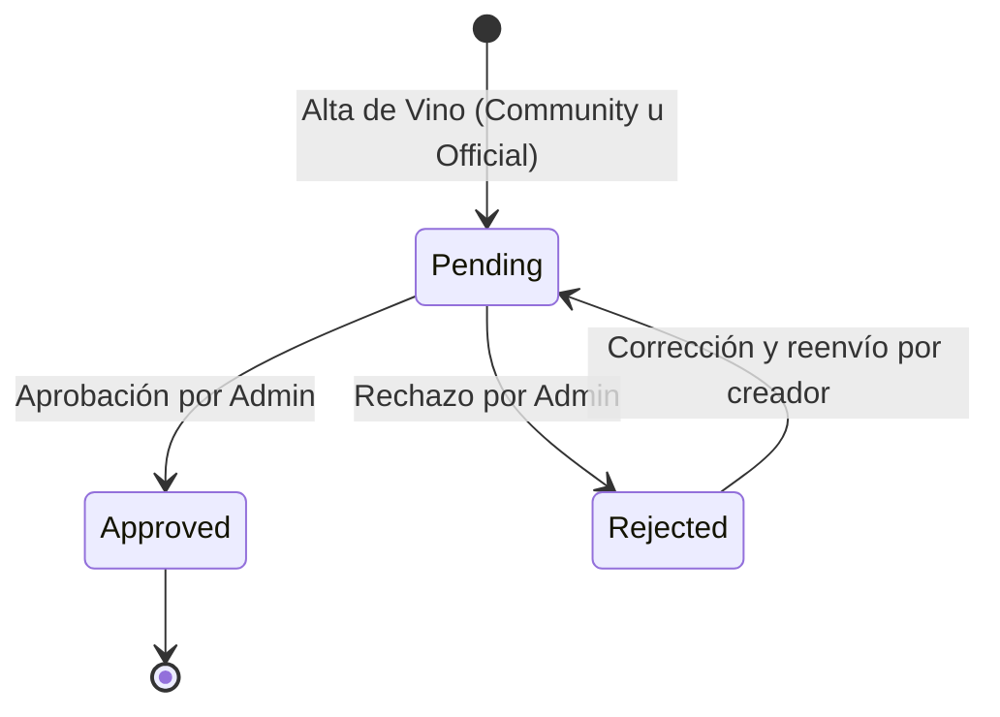
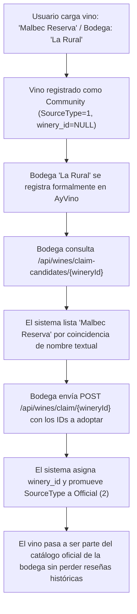

# Ciclo de Vida del Vino, Cortes, Reglas de Bodega y Reclamo Oficial - AyVino.Api

Este documento describe las reglas de negocio del dominio vitivinícola en AyVino: procedencia de botellas, estados de moderación, formulación de cortes de uva (blends), permisos para bodegas pendientes y el protocolo de adopción o reclamo de vinos por bodegas oficiales.

---

## 1. Procedencia y Tipos de Origen (`SourceType`)

Cada vino en el catálogo posee un origen explícito que define su grado de certificación institucional:

| Valor Enumérico | Identificador | Creador Típico | Características |
| :---: | :--- | :--- | :--- |
| `1` | `SourceType.Community` | Usuario / Aficionado | Creado cuando no se especifica una bodega oficial registrada (`winery_id IS NULL`). El usuario ingresa el nombre de la bodega en el campo textual `winery_name_text`. Se muestra con la etiqueta pública *"Agregado por la comunidad"*. |
| `2` | `SourceType.Official` | Bodega Verificada / Reclamo | Creado directamente por una bodega con cuenta oficial en la plataforma o promovido tras un proceso de reclamo exitoso (`claim`). |

---

## 2. Reglas de Catálogo y Bodega Pendiente (`WineryAccessRules`)

A partir de la ronda 2, se flexibiliza el proceso de onboarding para que las bodegas recién registradas puedan cargar sus productos de inmediato:

1. **Creación de Vinos y Añadas Propios (`CanPublish`)**:
   - Una bodega en estado `Pending` **PUEDE** crear sus etiquetas de vino oficiales y sus correspondientes añadas (inician como borradores con estado `Pending`).
   - Una bodega en estado `Approved` puede crear y publicar normalmente.
   - Una bodega en estado `Rejected` permanece **estrictamente bloqueada** para crear o publicar vinos.

2. **Reclamo de Vinos Comunitarios (`CanClaim`)**:
   - Reclamar vinos (`GET /api/wines/claim-candidates/{wineryId}` y `POST /api/wines/claim/{wineryId}`) sigue exigiendo **estrictamente** que la bodega esté `Approved`. Las bodegas `Pending` o `Rejected` no pueden certificar vinos de la comunidad.

---

## 3. Reglas de Visibilidad y Autenticación Opcional

Los endpoints públicos (`GET /api/wines`, `GET /api/wines/{id}`, `GET /api/wines/search`, `GET /api/wines/{wineId}/vintages`) implementan **autenticación opcional**:
- Si la petición incluye un token JWT válido en el header `Authorization: Bearer <token>`, el backend identifica al solicitante (`Actor`).
- Si la petición no incluye token o es anónima, se procesa sin arrojar `401 Unauthorized`.

### Matriz de Visibilidad:

| Contexto / Recurso | Público / Anónimo / Tercero | Dueño de la Bodega | Administrador (`Admin`) |
| :--- | :--- | :--- | :--- |
| **Vinos de bodega `Approved`** | Visibles si tienen al menos 1 cosecha `Approved` | Visibles todos | Visibles todos |
| **Vinos de bodega `Pending`** | **Ocultos** (retornan 404 en detalle y no figuran en listados/búsquedas) | **Visibles en su panel y fichas** (`GET /api/wines?wineryId=`) | Visibles todos |
| **Vinos de bodega `Rejected`** | **Ocultos** | **Ocultos** | Visibles |
| **Añadas `Approved`** | Visibles | Visibles | Visibles |
| **Añadas `Pending` / `Rejected`** | **Ocultas** | **Visibles para el dueño/uploader** | Visibles todas |

---

## 4. Estados de Moderación (`WineApprovalStatus`)

Todo vino nuevo ingresa con estado inicial `Pending` para garantizar la calidad del catálogo:

- **`1 = Pending`**: La cosecha/vino fue creado y está a la espera de revisión editorial o verificación de datos.
- **`2 = Approved`**: La cosecha/vino es visible en búsquedas públicas y listados generales.
- **`3 = Rejected`**: La cosecha/vino no cumple con los estándares mínimos de calidad (ej. datos apócrifos o duplicados manifiestos).

### Bandeja de Moderación Global de Cosechas
Para facilitar el control editorial, los administradores disponen del endpoint `GET /api/wine-vintages?pageNumber=1&pageSize=10&status=Pending` (`RequireAdmin`), que lista de forma paginada y centralizada todas las cosechas cargadas por usuarios y bodegas a la espera de aprobación, sin requerir la navegación individual etiqueta por etiqueta.

---

## 5. Cortes de Uva y Catálogo Oficial de Varietales (Blends)

AyVino modela la enología real permitiendo tanto varietales puros (100% de una cepa) como cortes multivarietales (blends).

### Reglas de Validación de Dominio:
1. **Existencia de Cepas**: Cada `GrapeId` provisto en el corte debe existir previamente en el catálogo de `grapes`.
2. **Restricción de Porcentaje (`CK_WineGrapes_Percentage`)**:
   - Todo porcentaje individual debe ser estrictamente mayor a `0` y menor o igual a `100.00%`.
   - La suma total de los porcentajes especificados en el blend no puede exceder el `100.00%`.
3. **Persistencia Transaccional**:
   Al crear o actualizar un vino (`WineRepository.CreateAsync` / `UpdateAsync`), la inserción en la tabla `wine_grapes` se efectúa dentro de la misma transacción física, garantizando atomicidad.

### Catálogo de 35 Uvas Tradicionales Argentinas (Migración `SeedGrapes` `20261022004`):
- **Tintas (`ColorType.Red = 1`)**: Malbec, Cabernet Sauvignon, Cabernet Franc, Merlot, Syrah, Bonarda, Pinot Noir, Tannat, Petit Verdot, Tempranillo, Sangiovese, Garnacha, Barbera, Pinot Meunier, Marselan, Touriga Nacional, Ancellotta.
- **Blancas (`ColorType.White = 2`)**: Pinot Gris, Chardonnay, Sauvignon Blanc, Torrontés Riojano, Torrontés Sanjuanino, Torrontés Mendocino, Semillón, Chenin Blanc, Viognier, Pedro Giménez, Moscatel de Alejandría, Riesling, Gewürztraminer, Verdejo, Albariño.
- **Rosadas (`ColorType.Rose = 3`)**: Criolla Grande, Cereza, Moscatel Rosado.

---

## 6. El Proceso de Reclamo Oficial (Wine Claim Flow)

Para resolver el problema del contenido generado por usuarios antes de que una bodega se sume a la plataforma, se implementa el flujo de reclamo ([RF-1.5](../requirements/spec.md)):

---

## 7. Catálogo de Enumeradores del Sistema

Valores numéricos e identificadores sincronizados con el código backend:

### A. Vinos y Bodegas
- **`WineType`**: `Red = 1`, `White = 2`, `Rose = 3`, `Sparkling = 4`, `Orange = 5`
- **`SourceType`**: `Community = 1`, `Official = 2`
- **`ApprovalStatus`**: `Pending = 1`, `Approved = 2`, `Rejected = 3`
- **`WineryStatus`**: `Pending = 1`, `Approved = 2`, `Rejected = 3`
- **`CityStatus`**: `Approved = 1`, `Pending = 2`, `Rejected = 3`

### B. Varietales y Cepas (Grapes)
- **`ColorType`**: `Red = 1`, `White = 2`, `Rose = 3`, `Orange = 4`
- **`TypicalBody`**: `Light = 10`, `MediumLight = 20`, `Medium = 30`, `MediumFull = 40`, `Full = 50`
- **`TypicalTannins`**: `Soft = 10`, `MediumSoft = 20`, `Medium = 30`, `MediumAstringent = 40`, `Astringent = 50`
- **`TypicalAcidity`**: `Low = 10`, `MediumLow = 20`, `Medium = 30`, `MediumHigh = 40`, `High = 50`

---

## 8. Protección del Historial de Usuarios en la Eliminación (Vinos y Cosechas)

Para salvaguardar la integridad de las experiencias y registros de los usuarios (reseñas, marcas personales en `user_wines` e inventario en cavas personales), la eliminación física de vinos y cosechas implementa validaciones estrictas previas a nivel de servicio y repositorio:

1. **Eliminación de Vinos (`DELETE /api/wines/{id}`)**:
   - Requiere rol Administrador (`RequireAdmin`).
   - El backend ejecuta una consulta optimizada única (`COUNT`) para evaluar el uso del vino antes de intentar el borrado.
   - Devuelve HTTP `409 Conflict` (`ConflictException`) con un mensaje claro y legible que incluye los conteos exactos si el vino:
     - Posee historial de usuarios: reseñas en alguna de sus cosechas, marcas en `user_wines` o botellas registradas en cavas personales (`cellar_items`). Formato: *"No se puede eliminar el vino porque tiene historial de usuarios (reseñas: X, marcas: Y, cava: Z). Si es un duplicado, usá la fusión."*
     - Posee otros vinos duplicados que fueron fusionados dentro de él (`wines.duplicate_of_wine_id = id`). Formato: *"No se puede eliminar el vino porque tiene vinos duplicados apuntándole (X). Si es un duplicado, usá la fusión."*
   - Si no posee historial ni vinos duplicados asociados, se elimina físicamente con código HTTP `204 NoContent`.
   - Un vino marcado como duplicado (`duplicate_of_wine_id IS NOT NULL`) que no posee historial propio sí puede ser eliminado físicamente.

2. **Eliminación de Cosechas (`DELETE /api/wines/{wineId}/vintages/{vintageId}`)**:
   - Requiere rol Administrador (`RequireAdmin`).
   - Devuelve HTTP `409 Conflict` (`ConflictException`) si la cosecha posee reseñas o botellas en cavas personales.
   - Mensaje: *"No se puede eliminar la cosecha porque tiene historial de usuarios (reseñas: X, cava: Y). Podés rechazarla en lugar de eliminarla para preservar el historial."*
   - Si la cosecha no posee historial de usuarios, se elimina físicamente con código HTTP `204 NoContent`.

---

---

## 8. Vinos Comunitarios, Visibilidad por Uso, Fotos Personales y Descorches

### 8.1. Visibilidad Comunitaria por Umbral de Usuarios ($N$ Configurable)
Para potenciar la inteligencia colectiva y la catalogación comunitaria sin comprometer la calidad del catálogo:
- **Umbral Configurable**: Mediante `Community:MinUsersForPublicVisibility` (por defecto `2`), se establece el número mínimo de usuarios independientes necesarios para que una cosecha comunitaria en estado `Pending` adquiera visibilidad pública general.
- **Conjunto de Usuarios Participantes**: Se define como el conjunto disjunto de:
  1. El creador/uploader original (`uploaded_by_user_id`).
  2. Usuarios que tienen al menos una botella de esa cosecha en su cava personal (`cellar_items`).
  3. Usuarios que han publicado una reseña sobre esa cosecha (`reviews`).
  4. Usuarios que han subido una foto personal de esa cosecha (`user_vintage_images`).
- **Estados de Visibilidad**:
  - `Approved`: Visible públicamente para cualquier usuario o visitante anónimo.
  - `Pending`: Visible para el público general si y solo si la cantidad de usuarios distintos $\ge N$. Antes de alcanzar dicho umbral, es visible únicamente para los administradores, el dueño de la bodega y los propios usuarios participantes. En la interfaz se rotula como *"Sin verificar"* hasta su aprobación editorial.
  - `Rejected`: Se oculta de inmediato para el público general y participantes ordinarios; únicamente visible para administradores, el dueño de la bodega y el uploader original.

### 8.2. Coincidencia de Etiquetas y Prevención de Duplicados
- **Normalizador de Etiquetas (`WineLabelNormalizer`)**: Genera una clave determinista `label_key` normalizando:
  - Texto a minúsculas invariantes.
  - Descomposición canónica FormD quitando marcas diacríticas (`NonSpacingMark`).
  - Caracteres no alfanuméricos tratados como espacios; espacios colapsados y recortados.
  - Clave compuesta: `nombre | bodega | tipo_de_vino`.
- **Detección Previa y Adopción**: El endpoint `GET /api/wines/match` permite verificar si un vino o cosecha ya existe antes de crearlo. Al intentar crear un vino o cosecha idéntica, el backend devuelve HTTP `409 Conflict` con extensiones Problem Details (`existingWineId`, `existingVintageId`), guiando al cliente hacia la adopción en vez de generar duplicados innecesarios.

### 8.3. Fotos Personales y Borrado Seguro
- **Independencia de Fotos Personales (`user_vintage_images`)**: Cada usuario puede asociar su propia foto a una cosecha mediante `PUT /api/wines/{wineId}/vintages/{vintageId}/my-image`. Esta foto personal es inviolable y nunca se pierde, incluso si la cosecha cambia de imagen pública oficial.
- **Regla de Primera Foto**: Si una cosecha comunitaria carece de imagen pública oficial (`wine_vintages.image_id IS NULL`) y el usuario que sube la foto personal es su uploader original, se asigna automáticamente esa misma imagen como foto pública de la cosecha (compartiendo referencia de archivo en Cloudinary). Los usuarios no-uploaders nunca modifican la foto pública.
- **Borrado Seguro por Conteo de Referencias**: Antes de eliminar físicamente un registro de `images` o su archivo en Cloudinary, `IImageRepository.IsReferencedAsync` verifica todas las tablas que pueden enlazarlo (`users.avatar_image_id`, `wineries.logo_image_id`, `wineries.banner_image_id`, `wine_vintages.image_id`, `user_vintage_images.image_id`). Si la imagen continúa referenciada en cualquier otra entidad, se preserva íntegra.

### 8.4. Moderación Administrativa de Aportes
- **Cola Priorizada**: En `GET /api/wine-vintages?status=Pending`, los registros se ordenan prioritariamente por `communityUsers DESC, registerDate ASC`, permitiendo al equipo editorial auditar primero aquellas cosechas con mayor tracción real.
- **Consulta de Aportes**: Mediante `GET /api/wine-vintages/{vintageId}/contributions`, el administrador accede al listado de usuarios participantes, sus fotos personales y la marca de creador original.
- **Promoción de Foto Oficial**: A través de `POST /api/wine-vintages/{vintageId}/promote-image`, el admin puede seleccionar la foto personal de cualquiera de los aportantes para convertirla en la imagen pública de la cosecha, registrando auditoría `VintageImagePromoted`.

### 8.5. Descorches y Marca Irreversible de "Probado"
- **Descorche Atómico (`POST /api/uncorks`)**: Ejecutado íntegramente dentro de una única transacción física ACID:
  1. Si se provee `CellarId`: Descuenta 1 botella mediante SQL atómico condicional (`quantity > 0`). Si el stock llega a 0, la fila se elimina automáticamente de la cava.
  2. Marca el vino como probado de forma irreversible e idempotente en `user_wines.is_tried = true`.
  3. Si incluye puntaje, realiza el upsert de la reseña y recalcula los acumulados en cascada (`wine_vintages` y `wines`).
  4. Registra la actividad `Uncorked` y, si la reseña fue creada nueva, también `Reviewed`.
  5. Rollback total ante cualquier contingencia.
- **Probado Permanente**: La condición de vino "probado" es acumulativa y no se revierte jamás al borrar un ítem de cava o descorchar botellas subsiguientes.

### 8.6. Historial de Actividades (`user_activities`)
- **Registro de Actos Personales**: Almacena cronológicamente los eventos ejecutados por el usuario (`Uncorked = 1`, `Reviewed = 2`, `AddedToCellar = 3`, `WineContributed = 4`). Marcas pasivas como "deseado" o "favorito" no generan eventos de actividad.
- **Privacidad Estricta**: Accesible exclusivamente por el propio usuario autenticado (`GET /api/users/me/history`). No se aplican filtros de visibilidad pública sobre los vinos referenciados, pues reflejan vivencias propias.

## 🔗 Referencias Relacionadas
- [[Especificacion_Requerimientos]]: Requerimientos RF-1.1 al RF-1.6.
- [[Catalogo_Endpoints_API]]: Endpoints `/api/wines` y `/api/grapes`.
- [[Base_De_Datos_Migraciones]]: Tablas `wines`, `wine_vintages` y `wine_grapes`.
- [[Flujos_De_Datos]]: Diagrama de secuencia del flujo de adopción de vinos.
