# Mapa de Navegación y Flujo de Usuario - AyVino Frontend

Este documento detalla la arquitectura de información, las vistas de la aplicación, el sistema de rutas protegidas y la experiencia interactiva (UX) del usuario en la SPA de AyVino.

---

## 1. Diagrama de Navegación y Guardias de Ruta

```mermaid
flowchart TD
    subgraph PublicRoutes["Rutas Públicas"]
        Landing["/ -> Landing.tsx (Hero + Muestra Curada)"]
        Login["/login -> LoginPage.tsx (Acceso con Estilo Editorial)"]
        Register["/register -> RegisterPage.tsx (Alta de Usuario Libre)"]
        Terms["/terms -> TermsPage.tsx (Términos y Condiciones)"]
        DetailModal["WineDetailModal (Ficha Técnica a 2 Columnas)"]
        CommunityModal["CommunityModal (Próximamente Editorial)"]
    end

    subgraph AuthPipeline["Autenticación & Autorización"]
        Guard["ProtectedRoute (Guardia por Rol)"]
        AuthContext["AuthContext (AuthProvider + useAuth)"]
    end

    subgraph ProtectedRoutes["Rutas Protegidas (Requieren Sesión)"]
        Dashboard["/dashboard (o /app) -> DashboardPage.tsx (Exploración & Bodegas)"]
        Cava["/cava -> CavaPage.tsx (Mi Cava & Inventario Personal)"]
        Pairing["/maridaje -> PairingPage.tsx (Curaduría & Maridaje)"]
        Catalog["/catalogo -> CatalogPage.tsx (Catálogo General)"]
        Account["/cuenta -> AccountPage.tsx (Mi Cuenta & Seguridad)"]
        WineryDash["/bodega/dashboard -> WineryDashboardPage.tsx (Exclusivo Bodega/Admin)"]
    end

    Landing -->|"Click en tarjeta de vino"| DetailModal
    Landing -->|"Click en 'Comunidad' (Navbar / Footer)"| CommunityModal
    Landing -->|"Navegación /login"| Login
    Landing -->|"Navegación /register"| Register
    Login -->|"Enlace a términos"| Terms
    Register -->|"Enlace a términos"| Terms
    Login -->|"Login exitoso (JWT + Refresh Token)"| AuthContext
    Register -->|"Registro exitoso"| AuthContext
    AuthContext -->|"Redirección post-login"| TargetRoute["Ruta original (from) o /dashboard"]

    Landing -->|"Navegación /dashboard"| Guard
    Landing -->|"Navegación /cava"| Guard
    Landing -->|"Navegación /maridaje"| Guard
    Landing -->|"Navegación /catalogo"| Guard
    Landing -->|"Navegación /cuenta"| Guard
    Landing -->|"Navegación /bodega/dashboard"| Guard

    Guard -->|"!isAuthenticated (con state.from)"| Login
    Guard -->|"isAuthenticated (Cualquier rol)"| Dashboard
    Guard -->|"Navegación /cava (Autenticado)"| Cava
    Guard -->|"Navegación /maridaje (Autenticado)"| Pairing
    Guard -->|"Navegación /catalogo (Autenticado)"| Catalog
    Guard -->|"Navegación /cuenta (Autenticado)"| Account
    Guard -->|"isAuthenticated + Rol Winery/Admin"| WineryDash
    Guard -->|"Rol no autorizado"| Dashboard

    Fallback["Ruta desconocida (*)"] -->|"Redirect"| Landing
```

---

## 2. Pantallas y Componentes Interactivos

### 2.1 Página de Inicio (`Landing.tsx`)
- **Estética Editorial de Cava Oscura (`#0f0f11` / `#141416`)**:
  - Fondo general carbón mate `#0f0f11`, eliminando fondos claros y sombras difusas.
  - Botones principales en bordó sólido `#6b1d28` (hover `#7e2432`) y secundarios outlined sobrios (`border-neutral-700 text-neutral-200`).
  - Metadatos técnicos, chips de categoría y procedencia en tipografía `font-mono tracking-widest text-[11px]`.
- **Sección Hero**:
  - Composición de una sola columna centrada (`max-w-5xl mx-auto text-center`) sobre atmósfera en capas y fondo profundo `#0a0a0c`.
  - Título editorial equilibrado (*"Descorchá nuevas historias, coleccioná cada copa"* en `font-semibold` con degradado cálido de texto en la segunda línea y `mb-6`).
  - Bajada amplia (`max-w-3xl`) con centrado estricto en `text-neutral-400`, vinculada a los CTAs mediante `mb-8`.
  - Botones de acción centrados con wrap en mobile (`flex-col sm:flex-row gap-5 mb-16 md:mb-20 px-4 px-6 py-3 text-sm`): *"Explorar catálogo"* (primario) y *"Crear cuenta libre"* (secundario con backdrop-blur).
  - Fila inferior de métricas centrada delimitada por borde sutil sobre un padding inferior amplio (`pb-28 sm:pb-32`).
- **Grilla de Vinos Curados**:
  - Renderizado de tarjetas de vino ([`WineCard.tsx`](../../src/frontend/src/features/wines/components/WineCard.tsx)) en contenedores `#141416` con bordes estructurales `border-neutral-800` en diseño a dos columnas.
  - **Minimalismo y escaneo visual rápido**: contiene únicamente silueta/foto de botella, varietal y añada (`font-mono`), nombre y bodega, calificación con cantidad de notas y botón sobrio *"Ver ficha"*. Totalmente libre de precios y descripciones redundantes.
- **Modal de Ficha Técnica** ([`WineDetailModal.tsx`](../../src/frontend/src/features/wines/components/WineDetailModal.tsx)):
  - Estructura a dos columnas: columna izquierda con escaparate de botella (foto o [`WineBottleSilhouette.tsx`](../../src/frontend/src/features/wines/components/WineBottleSilhouette.tsx)) y columna derecha con ficha técnica exhaustiva.
  - Desglose sensorial y técnico: puntaje, añada, crianza, notas de cata y aromas (copywriting cercano), descriptores, maridaje y origen/altura. Sin precios.
- **Modal de Comunidad** ([`CommunityModal.tsx`](../../src/frontend/src/components/community/CommunityModal.tsx)):
  - Modal sobrio de *"Próximamente"* activado desde el Navbar y el pie de página.
  - Titular en Serif noble, gráfico minimalista SVG en trazo fino (copas y mesa de cata) y texto explicativo sobre catas compartidas y clubes enológicos locales.

### 2.2 Pantalla de Inicio de Sesión (`LoginPage.tsx`) y Registro (`RegisterPage.tsx`)
- Vistas dedicadas (`/login` y `/register`) con layout split-card sobrio, equilibrado y sin scroll:
  - **Viewport**: Contenedor controlado sin scroll vertical (`h-screen overflow-hidden flex items-center justify-center p-4 bg-[#0e0e11]`).
  - **Tarjeta Central (Split Card)**: Altura contenida en desktop (`h-[88vh] max-h-[640px] w-full max-w-5xl`), esquinas redondeadas (`rounded-3xl`), desbordamiento oculto (`overflow-hidden`), sombra profunda (`shadow-2xl shadow-black/80`), borde sutil (`border border-white/10`) y grilla responsive a 2 columnas (`grid-cols-1 lg:grid-cols-2`).
  - **Columna Izquierda (Formulario)**:
    - Fondo oscuro grafito (`bg-[#141416]`) con distribución equilibrada (`p-8 md:p-10 flex flex-col justify-between h-full`).
    - Encabezado superior invertido: enlace de retorno `← Volver` a la izquierda y marca/isotipo de `AyVino` a la derecha.
    - Cabecera editorial con tags de colección (`"Colección Privada"` en Login y `"Membresía"` en Registro, `text-[10px] uppercase tracking-[0.25em] text-amber-200/60`), título destacado en tipografía Serif clásica (`font-serif text-3xl text-zinc-100 font-normal tracking-tight`, *"Bienvenido de nuevo"* en Login y *"Creá tu bodega personal"* en Registro) y subtítulo editorial descriptivo (`text-xs text-zinc-400 mt-2 font-sans font-light`).
    - **Validación Frontend Reactiva (sin popups del navegador)**:
      * Formulario configurado con `<form noValidate onSubmit={handleSubmit}>` para silenciar tooltips nativos.
      * Estado reactivo local de errores (`errors: Record<string, string>`) que valida campos obligatorios en el submit (`.trim()`).
      * En Registro: valida `name` (mapeado a `username`), `email`, `password` (mínimo 8 caracteres exigido por el backend), `confirmPassword`, coincidencia exacta de contraseñas y aceptación de términos.
      * Conexión persistente: invoca `registerApi` (`POST /api/users`) seguido de `loginApi` (`POST /api/auth/login`) para emisión de JWT real, sin depender de mocks ni demos en memoria.
      * Feedback visual contextual y sutil: borde rojizo `border-rose-500/70 focus:border-rose-500`, alerta de servidor ante conflictos (409) o desconexión, y mensaje discreto debajo de cada campo (`text-[10px] text-rose-400 mt-1 pl-1`).
      * Limpieza instantánea del error en el evento `onChange` al reanudar la escritura.
    - **Estilo de Inputs Clean Dark (Minimalista sin etiquetas externas)**: Solo cajón con placeholder descriptivo interior (`h-12 w-full rounded-xl px-4 text-sm font-sans bg-zinc-900/50 hover:bg-zinc-900/70 border border-zinc-800/80 focus:border-zinc-500 focus:bg-zinc-900 text-zinc-100 placeholder:text-zinc-500 transition-colors`).
    - Campos de contraseña interactivos con botón toggle sutil de ver/ocultar clave integrado a la derecha (`pr-11`, `Eye` / `EyeOff` en `text-zinc-500 hover:text-zinc-300`).
    - Botón de submit primario estilo sello de cava con curvas uniformes (`h-12 w-full rounded-xl bg-[#4f131f] hover:bg-[#5e1725] border border-rose-400/20 text-xs uppercase tracking-widest text-rose-100 font-medium transition-colors shadow-sm mt-2` con *"Iniciar sesión"* en Login y *"Crear cuenta"* en Register).
    - Footer inferior fijo abajo: enlace sobrio para alternar entre Iniciar Sesión y Crear Cuenta (sin botones demo ni texto legal redundante).
  - **Columna Derecha (Foto Vertical con Fusión Orgánica)**:
    - Oculta en móviles y visible en desktop (`hidden lg:flex h-full`).
    - Fotografía vertical nativa WebP de viñedos y cordillera (`auth-vineyard.webp`, `w-full h-full object-cover object-center`).
    - Tinte suave `bg-black/20`, capa superpuesta con degradado hacia el borde izquierdo (`bg-gradient-to-r from-[#141416] via-transparent to-transparent`) para fundirse armónicamente con la columna del formulario, y sutil degradado inferior `bg-gradient-to-t from-black/70 via-transparent to-transparent`.
    - Sin cajas ni contenedores artificiales: texto tipográfico plano en la parte inferior *"VALLE DE UCO · MENDOZA"* (`text-xs tracking-[0.3em] text-white/80 font-light uppercase`).

### 2.3 Pantalla Provisional de Términos y Condiciones (`TermsPage.tsx`)
- Vista pública accesible en `/terms` con estética editorial de cava oscura (`min-h-screen bg-[#0e0e11] text-zinc-100 flex flex-col items-center justify-center p-6`):
  - Tarjeta central flotante en `bg-zinc-900 border border-white/10 rounded-3xl p-8 md:p-10`.
  - Botón de navegación `← Volver` con retorno inteligente (`history.back()` o redirección al home).
  - Título en Serif noble (*"Términos y Condiciones"*) y mensaje explicativo de disponibilidad próxima.
  - Accesible desde los enlaces integrados en los formularios de autenticación (`/register` y `/login`).

### 2.4 Homepage / Exploración y Bodegas (`DashboardPage.tsx`)
- Vista principal post-login accesible en `/dashboard` (y alias `/app`):
  - **Barra de Navegación del Dashboard (`DashboardNavbar.tsx`)**:
    - Estética idéntica al Landing: completamente transparente en el tope (`scrollY <= 20`, `bg-transparent border-transparent`) y fondo translúcido mínimo con blur y borde sutil al reaparecer tras scrollear hacia arriba (`backdrop-blur-md bg-stone-950/60 border-b border-white/5`).
    - Efecto de scroll Smart Autohide: se mantiene visible durante todo el Hero inicial (`scrollY <= heroThreshold`) y solo se oculta al scrollear hacia abajo una vez superado el Hero (`-translate-y-full transition-all duration-300`), reapareciendo al scrollear hacia arriba (`translate-y-0`).
    - Navegación Central de Descubrimiento Global: reúne únicamente *"Explorar"* (scroll anclado a `#catalogo`), *"Maridaje"* (enlace a `/maridaje`) y *"Comunidad"* (con apertura de modal editorial `CommunityModal`), con tipografía y espaciado holgado (`gap-8` a `gap-10` con `whitespace-nowrap`).
    - Identidad de marca oficial `AyVino.` (con tipografía del Landing y punto borravino) con enlace directo a `/dashboard`.
    - Eliminación total del selector/píldora de ubicación.
    - Menú Desplegable Personal en Avatar (`z-50` y click-outside listener):
      * Encabezado: Nombre de usuario, email y badge de rol actual.
      * Bloque Colección: *"Mi Cava"* (enlace a `/cava` con badge dinámico de botellas), *"Mi historial"* y *"Deseados"*.
      * Separador sutil (`border-t border-white/5`).
      * Bloque Cuenta: *"Cuenta"* y *"Cerrar sesión"*.
  - **Hero Unificado y Barra de Métricas "Cava Strip" (`QuickActions.tsx` y `Metrics.tsx`)**:
    - Ajustado exactamente al primer pliegue del viewport (`h-[100dvh] min-h-[560px] flex flex-col justify-between pt-16 sm:pt-18 pb-2 sm:pb-3`):
      1. Saludo sutil: `"BUENOS DÍAS, [USUARIO]"` (`text-[11px] sm:text-xs tracking-[0.2em] text-stone-500 uppercase font-mono font-medium mb-0.5 sm:mb-1`).
      2. Título principal: *"¿Qué vamos a descorchar hoy?"* con acento gradiente en *"descorchar"* y escala armónica (`font-serif text-3xl sm:text-4xl lg:text-5xl font-semibold leading-[1.14]`).
      3. Subtítulo: *"Tu cava, tu historial de cata y las mejores bodegas argentinas..."* (`text-xs sm:text-sm text-stone-400 max-w-lg mx-auto font-sans leading-relaxed`).
      4. Barra de búsqueda única centrada tipo píldora (`rounded-full bg-stone-900/50 border border-white/10 max-w-xl sm:max-w-2xl mx-auto px-4 sm:px-5 py-1 mt-3.5 sm:mt-4`) con ícono `Search`, input de `h-10 sm:h-11` y botón circular `ArrowRight`.
      5. Segmented Filter Control integrado (`Varietal`, `Región`, `Bodega`) en cápsula de `w-full max-w-md sm:max-w-lg mx-auto p-1 mt-2.5 sm:mt-3` con botones optimizados (`py-1.5 sm:py-2 text-xs sm:text-sm`) y popovers `z-50`.
      6. **Barra de Métricas "Cava Strip" Horizontal (`Metrics.tsx`)**: Integrada limpiamente al pie (`mt-auto w-full pb-1 sm:pb-2`) en la misma vista inicial que el buscador sin recortes (`w-full max-w-5xl mx-auto pt-3 sm:pt-3.5 border-t border-white/5 grid grid-cols-2 md:grid-cols-4 gap-4 sm:gap-6 items-center text-left`):
        * **Total en Cava** (`Wine`): `24 Botellas` en Serif (`text-lg sm:text-xl`) + micro-texto *"Colección activa"*.
        * **Listas para Descorchar** (`Clock`): `3 Etiquetas` en Serif + micro-texto con punto verde esmeralda *"En ventana óptima"*.
        * **Varietal Insignia** (`Layers`): `Malbec (58%)` en Serif + micro-texto *"8 cepas registradas"*.
        * **Prestigio / Calificación** (`Award`): `4.9 ★` en Serif dorado + micro-texto *"Nivel Gran Reserva"*.
  - **Catálogo Exclusivo & Terroir ("Explorá por Bodegas") (`FilterChips.tsx` y `WineryBlock.tsx`)**:
    - Ubicado inmediatamente debajo del Hero y la Cava Strip (`pt-12 sm:pt-16 max-w-6xl mx-auto px-4`):
      * Eyebrow editorial: `"CATÁLOGO EXCLUSIVO & TERROIR"` (`font-mono tracking-[0.2em] text-rose-300/80`).
      * Titular en Serif: *"Explorá por Bodegas"* (`font-serif text-3xl sm:text-4xl text-stone-100`).
      * Subtítulo: *"Etiquetas oficiales y colecciones organizadas por productor y región vitivinícola."* (`text-stone-400 text-sm`).
    - Filtros por chips de cepa y región (Malbec, Cabernet, Blancos, Mendoza, Salta, Patagonia) combinados reactivamente con los filtros del Hero (`Varietal`, `Región`, `Bodega` y buscador de texto).
    - Agrupación por bodega (*Catena Zapata*, *Zuccardi*, *El Enemigo*, *Colomé*) con monograma circular y catálogo de etiquetas con botón *"Añadir a Cava"*.

### 2.5 Página de Mi Cava Personal (`CavaPage.tsx`)
- Vista post-login dedicada accesible en `/cava` (vinculada desde el menú desplegable del Avatar de usuario):
  - Encabezado con navegación contextual unificada (`DashboardNavbar.tsx`).
  - **Inventario y Gestión Personal de Cava (`DashboardSection.tsx`)**:
    - Control de demostración interactivo para conmutar entre estado *"Con stock registrado"* y *"Usuario nuevo (cava vacía)"*.
    - **Carrusel de Consumo Óptimo (`StockCarousel.tsx`)**: botellas listas para descorchar, navegación horizontal y tarjetas con badges de ventana de consumo recomendada.
    - **Diálogo Modal de Descorche (`UncorkDialog.tsx`)**: calificación interactiva en estrellas (1-5), ocasión de consumo y notas de cata personales con guardado de descorche.
  - Pie de página editorial integrado consistente con la plataforma.

### 2.6 El Arte del Maridaje (`PairingPage.tsx`)
- Vista post-login dedicada accesible en `/maridaje` (vinculada desde el enlace *"Maridaje"* del Navbar central):
  - Encabezado con navegación contextual unificada (`DashboardNavbar.tsx`).
  - **Empapelado Dinámico Editorial (`PairingWallpaper.tsx`)**: Textura de fondo SVG ultra sutil (`opacity-[0.05]`) en capa fija (`fixed inset-0 pointer-events-none -z-10`) con viñeta radial invertida que mantiene el centro de lectura despejado y revela sutilmente motivos de bistró/gastronomía en modo *"¿Qué vas a comer?"* y motivos de viñedo/bodega en modo *"¿Qué vas a tomar?"*, con transición cross-fade suave (`duration-700`).
  - **Hub Interactivo Bidireccional (`PairingInteractiveHub.tsx`)**:
    - **Header Editorial y Copy Cercano**: Título *"El Arte del Maridaje"* con bajada cálida y humana enfocada en disfrutar y maridar en la mesa cotidiana. Estructura visual con bordes limpios (`rounded-md` / `rounded-lg`) y estilo sobrio (`#121215`, acentos en borravino).
    - **Modo "¿Qué vas a comer?"**: Selección guiada entre 7 categorías gastronómicas (`carnes-rojas`, `pastas-rojas`, `pastas-blancas`, `aves`, `pescados-mariscos`, `quesos-tablas`, `postres-chocolates`). Despliega la sección *"Por qué funciona"* con explicaciones sensoriales y gastronómicas, barra horizontal compacta de servicio (temperatura óptima, cristalería sugerida y consejo de mesa) y cepas sugeridas con navegación interactiva directa.
    - **Modo "¿Qué vas a tomar?"**: Selección enológica entre 18 varietales y estilos (Malbec, Cabernet Sauvignon, Cabernet Franc, Bonarda, Syrah, Pinot Noir, Chardonnay, Torrontés, Sauvignon Blanc, etc.) con filtros rápidos por tipo de vino, descriptores organolépticos y saltos fluidos hacia platos afines.
    - **Vinculación con Catálogo Real (`WineCard` & `WineDetailModal`)**: Mapea etiquetas reales de la cava (`CURATED_WINES`) asociadas al maridaje activo con fotografía y ficha técnica interactiva, complementado con un bloque destacado de invitación al catálogo en selecciones sin partida de muestra asignada.
  - **Pautas de Guarda y Estiba (`PromoBlocks.tsx`)**: Mantenido en la sección complementaria inferior como guía de referencia de humedad, reposo y temperatura de cava.
  - Pie de página editorial integrado consistente con la plataforma.

### 2.7 Barra de Navegación Contextual (`Navbar.tsx`)
- Barra superior con diseño de cava oscura (`bg-[#0f0f11]/90 border-b border-neutral-800 text-neutral-200`) y tipografía `font-mono`:
  - **Estado Anónimo**: Exhibe enlaces de sección y accesos a *"Iniciar Sesión"* (`/login`) y *"Crear Cuenta"* (`/register`).
  - **Estado Autenticado**:
    - Enlace destacado a **Explorar** (`/dashboard`).
    - Enlace al Catálogo Protegido (`/catalogo`).
    - Enlace al Panel de Bodega (`/bodega/dashboard`) únicamente visible para roles `Winery` y `Admin`.
    - Píldora con nombre de usuario y badge de rol (`User`, `Winery`, `Admin`).
    - Botón de cierre de sesión (*"Salir"*) con llamada a `logout()` y redirección inmediata a `/` (`navigate('/', { replace: true })`).

### 2.8 Página de Mi Cuenta y Seguridad (`AccountPage.tsx`)
- Vista post-login dedicada accesible en `/cuenta` (vinculada desde el menú desplegable del Avatar de usuario y desde la Top Bar Contextual Slim de `/perfil`):
  - **Navegación Inmersiva**: Barra superior contextual minimalista (`ProfileTopBar.tsx`) con branding `AyVino.` y botón de escape directo `← Volver a Mi Perfil` (redirige a `/perfil/:username`), suprimiendo el Navbar global para maximizar el área útil.
  - **Sidebar con Jerarquía Sommelier**:
    * Avatar circular destacado (`w-28 h-28 sm:w-32 sm:h-32 rounded-full ring-4 ring-rose-950/40 border border-white/10 shadow-lg mx-auto object-cover`).
    * Nombre de usuario en tipografía Serif destacada (`font-serif text-xl sm:text-2xl text-white font-medium mt-3 tracking-tight text-center`) y correo en `text-xs sm:text-sm text-zinc-400`.
    * Botón *"Cargar foto"* compacto y sobrio (`bg-white/5 hover:bg-white/10 border border-white/10 rounded-md py-1.5 px-3 text-xs text-zinc-300`).
    * Navegación exclusiva de "CONFIGURACIÓN": "Mi Perfil" y "Seguridad y Contraseña" con píldora activa en borgoña profundo (`bg-[#6e1a24] text-white`).
    * Pie del sidebar con botón directo de "Cerrar sesión".
  - **Layout Abierto y Balanceado (Sin Doble Caja Aislada)**:
    * Eliminación del marco rectangular rígido para una integración fluida sobre el lienzo `#0b0b0e`.
    * Contenedor de ancho controlado (`max-w-3xl w-full`) con cabecera en `font-serif text-3xl text-white`, bajada descriptiva en `text-zinc-400 text-sm mt-1` y divisor `border-b border-white/5 pb-4 mb-6`.
    * Disposición de inputs en grilla balanceada (`grid grid-cols-1 sm:grid-cols-2 gap-4`), con la Biografía ocupando el ancho completo (`sm:col-span-2`).
    * Botones de acción alineados a la derecha y unificados en borgoña de marca (`bg-[#6e1a24] hover:bg-[#85222e] text-white font-medium px-6 py-2.5 rounded-lg shadow-sm`).

### 2.9 Página de Perfil de Usuario (`ProfilePage.tsx`)
- Vista accesible en `/perfil/:username` (pública y canónica) y `/perfil` (redirección contextual al usuario activo o `/login`).
- **Navegación Inmersiva Contextual**: Implementa [`ProfileTopBar.tsx`](../../src/frontend/src/components/layout/ProfileTopBar.tsx) fija en el tope (`h-14` con `bg-[#0b0b0e]/90` y backdrop-blur), con vía de escape explícita `← Volver a Explorar` hacia `/dashboard`, eliminando la sobrecarga cognitiva del Navbar global.
- **Banner Atmosférico & Identidad**:
  - Banner superior con altura optimizada (`h-28 sm:h-32 md:h-36`) y tema cromático vitivinícola 100% determinista en frontend calculado según el hash del username (5 presets de guarda: *Gran Reserva*, *Cava Nocturna*, *Roble Tostado*, *Sauvignon Oliva*, *Cosecha Tardía*).
  - **Avatar Circular Superpuesto**: Avatar circular (`rounded-full`) con solapamiento orgánico (`-mt-12 sm:-mt-14 relative z-10`), aro protector `ring-4 ring-[#0b0b0e]`, sombra profunda `shadow-2xl` y borde sutil `white/15`.
- **Jerarquía Tipográfica Editorial**:
  - Nombre de usuario en tipografía Serif noble (`font-serif text-3xl sm:text-4xl font-medium tracking-tight text-white`), completamente limpio sin píldoras ni badges artificiales para máxima pureza visual, en armonía con los títulos de sección.
  - Metadatos y biografía en tipografía Sans nítida (`text-zinc-200` y `text-zinc-300`), garantizando alto contraste sobre el fondo `#0b0b0e`.
  - Cifras estadísticas en bloque compacto `#17151a` usando `font-mono text-xl sm:text-2xl font-bold text-white`.
- **Navegación Segmentada**:
  - Pestañas en cápsula flotante (`bg-[#17151a] border border-white/10 rounded-md p-1`) con píldora activa en borgoña profundo (`bg-[#6e1a24] text-white`):
    * *Joyas de la Cava*: Mosaico curado de las botellas más destacadas/calificadas de la colección, con badge dinámico de botellas totales y enlace a `/cava`.
    * *Historial de Catas*: Mosaico de etiquetas descorchadas y notas sensoriales.
    * *Deseados & Favoritos*: Mosaico de vinos guardados con chips contextuales ("Favorito" / "Deseado").
- **Empty State Condicional e Interactivo**:
  - **Para el Dueño (`isOwner === true`)**: Grilla con slots punteados interactivos (`border-2 border-dashed border-rose-500/25 hover:border-rose-400/60 bg-[#17151a]/30`) e ícono `+` que invitan directamente a sumar la primera joya desde el catálogo (`/dashboard`).
  - **Para Visitantes (`isOwner === false`)**: Tarjeta editorial sobria en `#17151a` indicando "Cava en curación", con botones para explorar el catálogo general o crear su propia cuenta (sin dropzones ni slots punteados).
- **Mosaico de Botellas**:
  - Tarjetas con esquinas suavizadas `rounded-md` sobre `#17151a` y hover borgoña sutil (`hover:border-rose-900/40 hover:-translate-y-0.5`). Escaparate oscuro para silueta o imagen, varietal y añada en `font-mono`, bodega y calificación en estrellas doradas.

---

## 3. Vistas Protegidas y Políticas de Acceso

| Ruta | Componente | Acceso Permitido | Comportamiento si no cumple |
| :--- | :--- | :--- | :--- |
| `/` | `Landing.tsx` | Público (todos) | N/A |
| `/login` | `LoginPage.tsx` | Público (redirige a `state.from` o `/dashboard` si ya está autenticado) | N/A |
| `/register` | `RegisterPage.tsx` | Público (redirige a `/dashboard` si ya está autenticado) | N/A |
| `/terms` | `TermsPage.tsx` | Público (todos) | N/A |
| `/perfil/:username` | `ProfilePage.tsx` | Público (todos) | Si no existe el usuario: mensaje 404 sobrio |
| `/perfil` | Alias Redirección | Todos | Redirige a `/perfil/:myUsername` si está logueado, o `/login` si no |
| `/dashboard` | `DashboardPage.tsx` | Autenticado (`User`, `Winery`, `Admin`) | Redirige a `/login` pasando `{ from: location }` |
| `/cava` | `CavaPage.tsx` | Autenticado (`User`, `Winery`, `Admin`) | Redirige a `/login` pasando `{ from: location }` |
| `/maridaje` | `PairingPage.tsx` | Autenticado (`User`, `Winery`, `Admin`) | Redirige a `/login` pasando `{ from: location }` |
| `/cuenta` | `AccountPage.tsx` | Autenticado (`User`, `Winery`, `Admin`) | Redirige a `/login` pasando `{ from: location }` |
| `/app` | Alias Redirección | Redirige automáticamente a `/dashboard` | N/A |
| `/catalogo` | `CatalogPage.tsx` | Autenticado (`User`, `Winery`, `Admin`) | Redirige a `/login` pasando `{ from: location }` |
| `/bodega/dashboard` | `WineryDashboardPage.tsx` | Exclusivo `Winery` o `Admin` | Si no está autenticado: `/login` (`state.from`). Si no tiene rol: `/dashboard` |
| `*` | Redirección 404 | N/A | Redirige automáticamente a `/` |

---

## 🔗 Referencias Relacionadas
- [[Frontend_Overview]]: Stack tecnológico, Tailwind v4 y estilos.
- [[Catalogo_Endpoints_API]]: Especificación de endpoints que consumen estas pantallas.
- [[Especificacion_Requerimientos]]: Requerimientos funcionales de cada vista.

