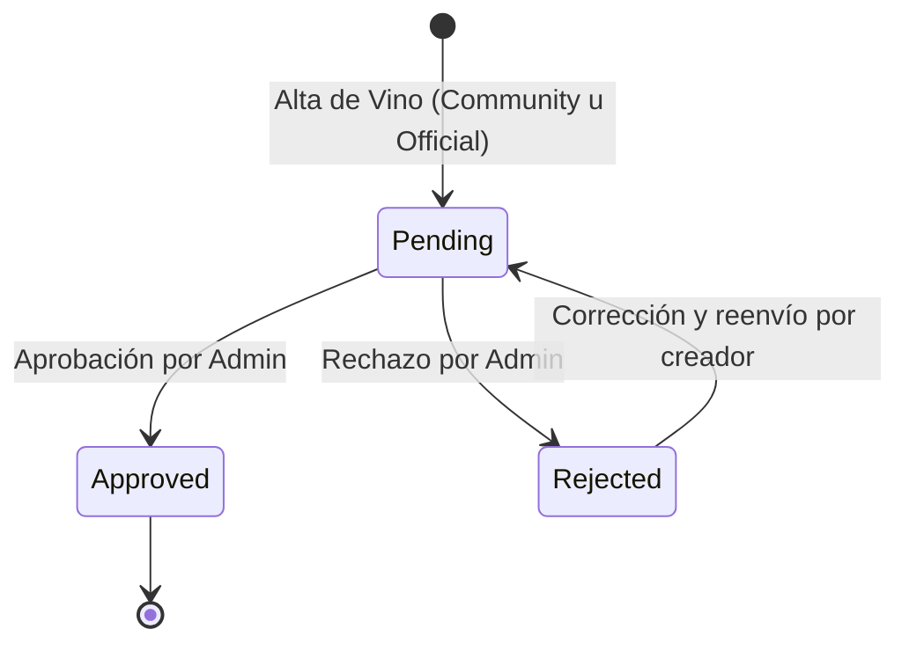
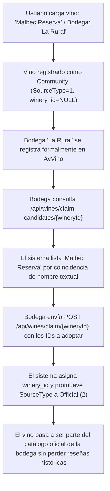

# Ciclo de Vida del Vino, Cortes, Reglas de Bodega y Reclamo Oficial - AyVino.Api

Este documento describe las reglas de negocio del dominio vitivinícola en AyVino: procedencia de botellas, estados de moderación, formulación de cortes de uva (blends), permisos para bodegas pendientes y el protocolo de adopción o reclamo de vinos por bodegas oficiales.

---

## 1. Procedencia y Tipos de Origen (`SourceType`)

Cada vino en el catálogo posee un origen explícito que define su grado de certificación institucional:

| Valor Enumérico | Identificador | Creador Típico | Características |
| :---: | :--- | :--- | :--- |
| `1` | `SourceType.Community` | Usuario / Aficionado | Creado cuando no se especifica una bodega oficial registrada (`winery_id IS NULL`). El usuario ingresa el nombre de la bodega en el campo textual `winery_name_text`. Se muestra con la etiqueta pública *"Agregado por la comunidad"*. |
| `2` | `SourceType.Official` | Bodega Verificada / Reclamo | Creado directamente por una bodega con cuenta oficial en la plataforma o promovido tras un proceso de reclamo exitoso (`claim`). |

---

## 2. Reglas de Catálogo y Bodega Pendiente (`WineryAccessRules`)

A partir de la ronda 2, se flexibiliza el proceso de onboarding para que las bodegas recién registradas puedan cargar sus productos de inmediato:

1. **Creación de Vinos y Añadas Propios (`CanPublish`)**:
   - Una bodega en estado `Pending` **PUEDE** crear sus etiquetas de vino oficiales y sus correspondientes añadas (inician como borradores con estado `Pending`).
   - Una bodega en estado `Approved` puede crear y publicar normalmente.
   - Una bodega en estado `Rejected` permanece **estrictamente bloqueada** para crear o publicar vinos.

2. **Reclamo de Vinos Comunitarios (`CanClaim`)**:
   - Reclamar vinos (`GET /api/wines/claim-candidates/{wineryId}` y `POST /api/wines/claim/{wineryId}`) sigue exigiendo **estrictamente** que la bodega esté `Approved`. Las bodegas `Pending` o `Rejected` no pueden certificar vinos de la comunidad.

---

## 3. Reglas de Visibilidad y Autenticación Opcional

Los endpoints públicos (`GET /api/wines`, `GET /api/wines/{id}`, `GET /api/wines/search`, `GET /api/wines/{wineId}/vintages`) implementan **autenticación opcional**:
- Si la petición incluye un token JWT válido en el header `Authorization: Bearer <token>`, el backend identifica al solicitante (`Actor`).
- Si la petición no incluye token o es anónima, se procesa sin arrojar `401 Unauthorized`.

### Matriz de Visibilidad:

| Contexto / Recurso | Público / Anónimo / Tercero | Dueño de la Bodega | Administrador (`Admin`) |
| :--- | :--- | :--- | :--- |
| **Vinos de bodega `Approved`** | Visibles si tienen al menos 1 cosecha `Approved` | Visibles todos | Visibles todos |
| **Vinos de bodega `Pending`** | **Ocultos** (retornan 404 en detalle y no figuran en listados/búsquedas) | **Visibles en su panel y fichas** (`GET /api/wines?wineryId=`) | Visibles todos |
| **Vinos de bodega `Rejected`** | **Ocultos** | **Ocultos** | Visibles |
| **Añadas `Approved`** | Visibles | Visibles | Visibles |
| **Añadas `Pending` / `Rejected`** | **Ocultas** | **Visibles para el dueño/uploader** | Visibles todas |

---

## 4. Estados de Moderación (`WineApprovalStatus`)

Todo vino nuevo ingresa con estado inicial `Pending` para garantizar la calidad del catálogo:

- **`1 = Pending`**: La cosecha/vino fue creado y está a la espera de revisión editorial o verificación de datos.
- **`2 = Approved`**: La cosecha/vino es visible en búsquedas públicas y listados generales.
- **`3 = Rejected`**: La cosecha/vino no cumple con los estándares mínimos de calidad (ej. datos apócrifos o duplicados manifiestos).

### Bandeja de Moderación Global de Cosechas
Para facilitar el control editorial, los administradores disponen del endpoint `GET /api/wine-vintages?pageNumber=1&pageSize=10&status=Pending` (`RequireAdmin`), que lista de forma paginada y centralizada todas las cosechas cargadas por usuarios y bodegas a la espera de aprobación, sin requerir la navegación individual etiqueta por etiqueta.

---

## 5. Cortes de Uva y Catálogo Oficial de Varietales (Blends)

AyVino modela la enología real permitiendo tanto varietales puros (100% de una cepa) como cortes multivarietales (blends).

### Reglas de Validación de Dominio:
1. **Existencia de Cepas**: Cada `GrapeId` provisto en el corte debe existir previamente en el catálogo de `grapes`.
2. **Restricción de Porcentaje (`CK_WineGrapes_Percentage`)**:
   - Todo porcentaje individual debe ser estrictamente mayor a `0` y menor o igual a `100.00%`.
   - La suma total de los porcentajes especificados en el blend no puede exceder el `100.00%`.
3. **Persistencia Transaccional**:
   Al crear o actualizar un vino (`WineRepository.CreateAsync` / `UpdateAsync`), la inserción en la tabla `wine_grapes` se efectúa dentro de la misma transacción física, garantizando atomicidad.

### Catálogo de 35 Uvas Tradicionales Argentinas (Migración `SeedGrapes` `20261022004`):
- **Tintas (`ColorType.Red = 1`)**: Malbec, Cabernet Sauvignon, Cabernet Franc, Merlot, Syrah, Bonarda, Pinot Noir, Tannat, Petit Verdot, Tempranillo, Sangiovese, Garnacha, Barbera, Pinot Meunier, Marselan, Touriga Nacional, Ancellotta.
- **Blancas (`ColorType.White = 2`)**: Pinot Gris, Chardonnay, Sauvignon Blanc, Torrontés Riojano, Torrontés Sanjuanino, Torrontés Mendocino, Semillón, Chenin Blanc, Viognier, Pedro Giménez, Moscatel de Alejandría, Riesling, Gewürztraminer, Verdejo, Albariño.
- **Rosadas (`ColorType.Rose = 3`)**: Criolla Grande, Cereza, Moscatel Rosado.

---

## 6. El Proceso de Reclamo Oficial (Wine Claim Flow)

Para resolver el problema del contenido generado por usuarios antes de que una bodega se sume a la plataforma, se implementa el flujo de reclamo ([RF-1.5](../requirements/spec.md)):

---

## 7. Catálogo de Enumeradores del Sistema

Valores numéricos e identificadores sincronizados con el código backend:

### A. Vinos y Bodegas
- **`WineType`**: `Red = 1`, `White = 2`, `Rose = 3`, `Sparkling = 4`, `Orange = 5`
- **`SourceType`**: `Community = 1`, `Official = 2`
- **`ApprovalStatus`**: `Pending = 1`, `Approved = 2`, `Rejected = 3`
- **`WineryStatus`**: `Pending = 1`, `Approved = 2`, `Rejected = 3`
- **`CityStatus`**: `Approved = 1`, `Pending = 2`, `Rejected = 3`

### B. Varietales y Cepas (Grapes)
- **`ColorType`**: `Red = 1`, `White = 2`, `Rose = 3`, `Orange = 4`
- **`TypicalBody`**: `Light = 10`, `MediumLight = 20`, `Medium = 30`, `MediumFull = 40`, `Full = 50`
- **`TypicalTannins`**: `Soft = 10`, `MediumSoft = 20`, `Medium = 30`, `MediumAstringent = 40`, `Astringent = 50`
- **`TypicalAcidity`**: `Low = 10`, `MediumLow = 20`, `Medium = 30`, `MediumHigh = 40`, `High = 50`

---

## 8. Protección del Historial de Usuarios en la Eliminación (Vinos y Cosechas)

Para salvaguardar la integridad de las experiencias y registros de los usuarios (reseñas, marcas personales en `user_wines` e inventario en cavas personales), la eliminación física de vinos y cosechas implementa validaciones estrictas previas a nivel de servicio y repositorio:

1. **Eliminación de Vinos (`DELETE /api/wines/{id}`)**:
   - Requiere rol Administrador (`RequireAdmin`).
   - El backend ejecuta una consulta optimizada única (`COUNT`) para evaluar el uso del vino antes de intentar el borrado.
   - Devuelve HTTP `409 Conflict` (`ConflictException`) con un mensaje claro y legible que incluye los conteos exactos si el vino:
     - Posee historial de usuarios: reseñas en alguna de sus cosechas, marcas en `user_wines` o botellas registradas en cavas personales (`cellar_items`). Formato: *"No se puede eliminar el vino porque tiene historial de usuarios (reseñas: X, marcas: Y, cava: Z). Si es un duplicado, usá la fusión."*
     - Posee otros vinos duplicados que fueron fusionados dentro de él (`wines.duplicate_of_wine_id = id`). Formato: *"No se puede eliminar el vino porque tiene vinos duplicados apuntándole (X). Si es un duplicado, usá la fusión."*
   - Si no posee historial ni vinos duplicados asociados, se elimina físicamente con código HTTP `204 NoContent`.
   - Un vino marcado como duplicado (`duplicate_of_wine_id IS NOT NULL`) que no posee historial propio sí puede ser eliminado físicamente.

2. **Eliminación de Cosechas (`DELETE /api/wines/{wineId}/vintages/{vintageId}`)**:
   - Requiere rol Administrador (`RequireAdmin`).
   - Devuelve HTTP `409 Conflict` (`ConflictException`) si la cosecha posee reseñas o botellas en cavas personales.
   - Mensaje: *"No se puede eliminar la cosecha porque tiene historial de usuarios (reseñas: X, cava: Y). Podés rechazarla en lugar de eliminarla para preservar el historial."*
   - Si la cosecha no posee historial de usuarios, se elimina físicamente con código HTTP `204 NoContent`.

