# Mapa de Navegación y Flujo de Usuario - AyVino Frontend

Este documento detalla la arquitectura de información, las vistas de la aplicación, el sistema de rutas protegidas y la experiencia interactiva (UX) del usuario en la SPA de AyVino.

---

## 1. Diagrama de Navegación y Guardias de Ruta

```mermaid
flowchart TD
    subgraph PublicRoutes["Rutas Públicas"]
        Landing["/ -> Landing.tsx (Hero + Muestra Curada)"]
        Login["/login -> LoginPage.tsx (Acceso con Estilo Editorial)"]
        Register["/register -> RegisterPage.tsx (Alta de Usuario Libre)"]
        Terms["/terms -> TermsPage.tsx (Términos y Condiciones)"]
        DetailModal["WineDetailModal (Ficha Técnica a 2 Columnas)"]
        CommunityModal["CommunityModal (Próximamente Editorial)"]
    end

    subgraph AuthPipeline["Autenticación & Autorización"]
        Guard["ProtectedRoute (Guardia por Rol)"]
        AuthContext["AuthContext (AuthProvider + useAuth)"]
    end

    subgraph ProtectedRoutes["Rutas Protegidas (Requieren Sesión)"]
        Dashboard["/dashboard (o /app) -> DashboardPage.tsx (Exploración & Bodegas)"]
        Cava["/cava -> CavaPage.tsx (Mi Cava & Inventario Personal)"]
        Pairing["/maridaje -> PairingPage.tsx (Curaduría & Maridaje)"]
        Catalog["/catalogo -> CatalogPage.tsx (Catálogo General)"]
        
        subgraph WineryArea["Área Exclusiva de Bodega (/bodega/*)"]
            WineryLayoutComponent["WineryLayout.tsx (Header + Sidebar + Contexto)"]
            WineryDash["/bodega/dashboard -> WineryDashboardPage.tsx"]
            WineryLayoutComponent --> WineryDash
        end
    end

    Landing -->|"Click en tarjeta de vino"| DetailModal
    Landing -->|"Click en 'Comunidad' (Navbar / Footer)"| CommunityModal
    Landing -->|"Navegación /login"| Login
    Landing -->|"Navegación /register"| Register
    Login -->|"Enlace a términos"| Terms
    Register -->|"Enlace a términos"| Terms
    Login -->|"Login exitoso (JWT + Refresh Token)"| AuthContext
    Register -->|"Registro exitoso"| AuthContext
    AuthContext -->|"Redirección post-login"| TargetRoute["Ruta original (from) o /dashboard o /bodega/dashboard"]

    Landing -->|"Navegación /dashboard"| Guard
    Landing -->|"Navegación /cava"| Guard
    Landing -->|"Navegación /maridaje"| Guard
    Landing -->|"Navegación /catalogo"| Guard
    Landing -->|"Navegación /bodega/*"| Guard

    Guard -->|"!isAuthenticated (con state.from)"| Login
    Guard -->|"isAuthenticated (Cualquier rol)"| Dashboard
    Guard -->|"Navegación /cava (Autenticado)"| Cava
    Guard -->|"Navegación /maridaje (Autenticado)"| Pairing
    Guard -->|"Navegación /catalogo (Autenticado)"| Catalog
    Guard -->|"isAuthenticated + Rol Winery/Admin"| WineryLayoutComponent
    Guard -->|"Rol no autorizado"| Dashboard

    Fallback["Ruta desconocida (*)"] -->|"Redirect"| Landing
```

---

## 2. Pantallas y Componentes Interactivos

### 2.1 Página de Inicio (`Landing.tsx`)
- **Estética Editorial de Cava Oscura (`#0f0f11` / `#141416`)**:
  - Fondo general carbón mate `#0f0f11`, eliminando fondos claros y sombras difusas.
  - Botones principales en bordó sólido `#6b1d28` (hover `#7e2432`) y secundarios outlined sobrios (`border-neutral-700 text-neutral-200`).
  - Metadatos técnicos, chips de categoría y procedencia en tipografía `font-mono tracking-widest text-[11px]`.
- **Sección Hero**:
  - Composición de una sola columna centrada (`max-w-5xl mx-auto text-center`) sobre atmósfera en capas y fondo profundo `#0a0a0c`.
  - Título editorial equilibrado (*"Descorchá nuevas historias, coleccioná cada copa"* en `font-semibold` con degradado cálido de texto en la segunda línea y `mb-6`).
  - Bajada amplia (`max-w-3xl`) con centrado estricto en `text-neutral-400`, vinculada a los CTAs mediante `mb-8`.
  - Botones de acción centrados con wrap en mobile (`flex-col sm:flex-row gap-5 mb-16 md:mb-20 px-4 px-6 py-3 text-sm`): *"Explorar catálogo"* (primario) y *"Crear cuenta libre"* (secundario con backdrop-blur).
  - Fila inferior de métricas centrada delimitada por borde sutil sobre un padding inferior amplio (`pb-28 sm:pb-32`).
- **Grilla de Vinos Curados**:
  - Renderizado de tarjetas de vino ([`WineCard.tsx`](../../src/frontend/src/features/wines/components/WineCard.tsx)) en contenedores `#141416` con bordes estructurales `border-neutral-800` en diseño a dos columnas.
  - **Minimalismo y escaneo visual rápido**: contiene únicamente silueta/foto de botella, varietal y añada (`font-mono`), nombre y bodega, calificación con cantidad de notas y botón sobrio *"Ver ficha"*. Totalmente libre de precios y descripciones redundantes.
- **Modal de Ficha Técnica** ([`WineDetailModal.tsx`](../../src/frontend/src/features/wines/components/WineDetailModal.tsx)):
  - Estructura a dos columnas: columna izquierda con escaparate de botella (foto o [`WineBottleSilhouette.tsx`](../../src/frontend/src/features/wines/components/WineBottleSilhouette.tsx)) y columna derecha con ficha técnica exhaustiva.
  - Desglose sensorial y técnico: puntaje, añada, crianza, notas de cata y aromas (copywriting cercano), descriptores, maridaje y origen/altura. Sin precios.
- **Modal de Comunidad** ([`CommunityModal.tsx`](../../src/frontend/src/components/community/CommunityModal.tsx)):
  - Modal sobrio de *"Próximamente"* activado desde el Navbar y el pie de página.
  - Titular en Serif noble, gráfico minimalista SVG en trazo fino (copas y mesa de cata) y texto explicativo sobre catas compartidas y clubes enológicos locales.

### 2.2 Pantalla de Inicio de Sesión (`LoginPage.tsx`) y Registro (`RegisterPage.tsx`)
- Vistas dedicadas (`/login` y `/register`) con layout split-card sobrio, equilibrado y sin scroll.
- Validación reactiva sin tooltips nativos del navegador (`noValidate`), manejo de errores en estado de React (`errors: Record<string, string>`), y conexión con `loginApi` y `registerApi`.

### 2.3 Panel de Bodega (`WineryLayout.tsx` y `/bodega/*`)
- **Contenedor Principal (`WineryLayout.tsx`)**:
  - Enrutamiento anidado bajo `/bodega/*` exclusivo para roles `Winery` y `Admin`.
  - Header superior de gestión: Branding `AyVino.`, nombre y monograma circular de la bodega, enlace directo hacia *"Ver perfil público"* y menú de sesión.
  - Barra lateral de navegación (Sidebar): Accesos a Dashboard (`/bodega/dashboard`), Mi Perfil (`/bodega/perfil`), Mis Vinos (`/bodega/vinos`), Reclamar Vinos (`/bodega/reclamar`) y retorno al catálogo general (`/dashboard`).
  - Drawer móvil con navegación táctil fluida.
  - Proveedor `WineryContext` que consume `useMyWinery()` y distribuye el estado de la bodega en tiempo de ejecución.
  - **Banner de Moderación (`WineryStatusBanner.tsx`)**: Feedback continuo cuando la bodega está `Pending` o `Rejected`.
  - **Manejo Amable de Cuenta sin Bodega (404)**: Presenta una vista explicativa cuando el usuario con rol de bodega no posee aún una bodega registrada en la base de datos, con enlaces directos para registrarla o regresar al catálogo.

---

## 3. Vistas Protegidas y Políticas de Acceso

| Ruta | Componente | Acceso Permitido | Comportamiento si no cumple |
| :--- | :--- | :--- | :--- |
| `/` | `Landing.tsx` | Público (todos) | N/A |
| `/login` | `LoginPage.tsx` | Público (redirige a `state.from`, `/bodega/dashboard` o `/dashboard`) | N/A |
| `/register` | `RegisterPage.tsx` | Público (redirige a `/dashboard` si ya está autenticado) | N/A |
| `/terms` | `TermsPage.tsx` | Público (todos) | N/A |
| `/dashboard` | `DashboardPage.tsx` | Autenticado (`User`, `Winery`, `Admin`) | Redirige a `/login` pasando `{ from: location }` |
| `/cava` | `CavaPage.tsx` | Autenticado (`User`, `Winery`, `Admin`) | Redirige a `/login` pasando `{ from: location }` |
| `/maridaje` | `PairingPage.tsx` | Autenticado (`User`, `Winery`, `Admin`) | Redirige a `/login` pasando `{ from: location }` |
| `/app` | Alias Redirección | Redirige automáticamente a `/dashboard` | N/A |
| `/catalogo` | `CatalogPage.tsx` | Autenticado (`User`, `Winery`, `Admin`) | Redirige a `/login` pasando `{ from: location }` |
| `/bodega` | `WineryLayout.tsx` | Exclusivo `Winery` o `Admin` | Redirige internamente a `/bodega/dashboard` |
| `/bodega/dashboard` | `WineryDashboardPage.tsx` | Exclusivo `Winery` o `Admin` | Si no está autenticado: `/login` (`state.from`). Si no tiene rol: `/dashboard` |
| `*` | Redirección 404 | N/A | Redirige automáticamente a `/` |
