# Mapa de Navegación y Flujo de Usuario - AyVino Frontend

Este documento detalla la arquitectura de información, las vistas de la aplicación, el sistema de rutas protegidas y la experiencia interactiva (UX) del usuario en la SPA de AyVino (Data Router v7).

---

## 1. Diagrama de Navegación y Guardias de Ruta

```mermaid
flowchart TD
    subgraph PublicRoutes["Rutas Públicas bajo RootLayout"]
        Landing["/ -> Landing.tsx (Hero + Muestra Curada + Franja Bodegas)"]
        Login["/login -> LoginPage.tsx (Acceso Editorial con Redirección Contextual)"]
        Register["/register -> RegisterPage.tsx (Alta de Usuario Libre)"]
        Terms["/terms -> TermsPage.tsx (Términos y Condiciones)"]
        WineryRegister["/bodega/registro -> WineryRegisterPage.tsx (Alta Unificada Split-Card)"]
        DetailModal["WineDetailModal (Ficha Técnica a 2 Columnas)"]
        CommunityModal["CommunityModal (Próximamente Editorial)"]

        subgraph WineryPublic["Vistas Públicas de Bodega (WineryPublicLayout)"]
            ForWineries["/para-bodegas -> ForWineriesPage.tsx (Propuesta de Valor)"]
            WineryPublicProfile["/bodegas/:id -> WineryPublicProfilePage.tsx (Vidriera Pública)"]
        end
    end

    subgraph AuthPipeline["Autenticación & Autorización"]
        Guard["ProtectedRoute (Guardia por Rol)"]
        AuthContext["AuthContext (AuthProvider + useAuth)"]
    end

    subgraph ProtectedRoutes["Rutas Protegidas bajo AppLayout (Usuarios y Sommeliers)"]
        Layout["AppLayout (<Outlet /> + stockCount Context + DashboardNavbar)"]
        Dashboard["/dashboard (o /app) -> DashboardPage.tsx"]
        Cava["/cava -> CavaPage.tsx (Mi Cava & Inventario Personal)"]
        Pairing["/maridaje -> PairingPage.tsx (Curaduría & Maridaje)"]
        Catalog["/catalogo -> CatalogPage.tsx (Catálogo General)"]
        Account["/cuenta -> AccountPage.tsx (Mi Cuenta y Seguridad)"]
        Profile["/perfil/:username -> ProfilePage.tsx (Perfil Público Sommelier)"]
        ProfileRedirect["/perfil -> ProfileRedirectRoute (Redirección a perfil propio)"]

        Layout --> Dashboard
        Layout --> Cava
        Layout --> Pairing
        Layout --> Catalog
        Layout --> Account
    end

    subgraph WineryArea["Área Institucional de Bodega (/bodega/*)"]
        WineryLayoutComponent["WineryLayout.tsx (WineryNavbar Superior + Contexto Memoizado)"]
        WineryDash["/bodega/dashboard -> WineryDashboardPage.tsx"]
        WineryProfile["/bodega/perfil -> WineryOverviewPage.tsx (Ficha con Banner)"]
        WineryConfig["/bodega/configuracion -> WineryConfigPage.tsx (Configuración Inmersiva)"]
        WineryWines["/bodega/vinos -> WineryCatalogPage.tsx"]
        WineryWineDetail["/bodega/vinos/:wineId -> WineryWineDetailPage.tsx"]
        WineryClaim["/bodega/reclamar -> WineryClaimPage.tsx"]
        WineCreateModalComponent["WineCreateModal (Alta + Corte Varietal)"]
        WineVintagesModalComponent["WineVintagesModal (Gestión de Cosechas)"]

        WineryLayoutComponent --> WineryDash
        WineryLayoutComponent --> WineryProfile
        WineryLayoutComponent --> WineryConfig
        WineryLayoutComponent --> WineryWines
        WineryLayoutComponent --> WineryClaim
        WineryWines --> WineCreateModalComponent
        WineryWines --> WineVintagesModalComponent
    end

    subgraph AdminArea["Panel de Administración (/admin/*)"]
        AdminLayoutComponent["AdminLayout.tsx (Sidebar + Header + ToastProvider)"]
        AdminDash["/admin -> AdminDashboardPage.tsx (KPIs y Pendientes)"]
        AdminWineries["/admin/bodegas -> AdminWineriesPage.tsx (Moderación)"]
        AdminCities["/admin/ciudades -> AdminCitiesPage.tsx (Moderación)"]
        AdminVintages["/admin/cosechas -> AdminVintagesPage.tsx (Moderación Cosechas)"]
        AdminUsers["/admin/usuarios -> AdminUsersPage.tsx (Gestión Cuentas)"]
        AdminGrapes["/admin/uvas -> AdminGrapesPage.tsx (Catálogo Variedades)"]
        AdminPairings["/admin/maridajes -> AdminPairingsPage.tsx (Catálogo Maridajes)"]

        AdminLayoutComponent --> AdminDash
        AdminLayoutComponent --> AdminWineries
        AdminLayoutComponent --> AdminCities
        AdminLayoutComponent --> AdminVintages
        AdminLayoutComponent --> AdminUsers
        AdminLayoutComponent --> AdminGrapes
        AdminLayoutComponent --> AdminPairings
    end

    Landing -->|"Click en 'Comunidad' (Navbar / Footer)"| CommunityModal
    Landing -->|"Click en 'Para bodegas' (Navbar / Banner)"| ForWineries
    ForWineries -->|"Click en 'Registrar mi bodega'"| WineryRegister
    Landing -->|"Navegación /login"| Login
    Landing -->|"Navegación /register"| Register
    Landing -->|"Enlace /bodegas/:id"| WineryPublicProfile
    WineryPublicProfile -->|"Click en vino oficial"| DetailModal
    Login -->|"Login exitoso (JWT + Refresh Token)"| AuthContext
    Register -->|"Registro exitoso"| AuthContext
    WineryRegister -->|"Registro + Login automático"| AuthContext
    AuthContext -->|"Redirección post-login"| TargetRoute["Ruta solicitada, /admin, /bodega/dashboard o /dashboard"]

    Landing -->|"Navegación /dashboard"| Guard
    Landing -->|"Navegación /bodega/*"| Guard
    Landing -->|"Navegación /admin/*"| Guard

    Guard -->|"!isAuthenticated (con state.from)"| Login
    Guard -->|"isAuthenticated (Rol User/Admin)"| Layout
    Guard -->|"isAuthenticated + Rol Winery/Admin"| WineryLayoutComponent
    Guard -->|"isAuthenticated + Rol Admin"| AdminLayoutComponent
    Guard -->|"Rol no autorizado"| Dashboard

    Fallback["Ruta desconocida (*)"] -->|"Redirect"| Landing
```

---

## 2. Pantallas y Componentes Interactivos

### 2.1 Páginas Públicas y de Acceso
- **Landing (`Landing.tsx`)**: Hero editorial, muestra curada de etiquetas y franja promocional para bodegas.
- **Acceso y Registro Sommelier (`LoginPage.tsx` / `RegisterPage.tsx`)**:
  - Formularios split-card con validaciones reactivas.
  - Redirección por rol en login: los usuarios con rol `Winery` ingresan directo a `/bodega/dashboard`.
- **Portal de Bodegas (`ForWineriesPage.tsx` en `/para-bodegas`)**: Presentación editorial de ventajas competitivas (certificación técnica, reclamo de vinos, seguidores).
- **Registro de Bodega (`WineryRegisterPage.tsx` en `/bodega/registro`)**: Formulario split-card en 2 pasos con geolocalización interactiva vía `RegionPicker`.

### 2.2 Vidriera Pública Institucional (`WineryPublicProfilePage.tsx` en `/bodegas/:id`)
- Acceso universal (visitantes y sommeliers).
- Cabecera con monograma/logo de bodega, terruño resuelto, año de fundación y botón interactivo *"Seguir bodega"*.
- Desacoplado 100% de `features/wines`: utiliza `WineryPublicWineCard` y `WineryPublicWineDetailModal`.

### 2.3 Panel Institucional de Bodega (`WineryLayout.tsx` en `/bodega/*`)
- **Navegación Superior Persistente (`WineryNavbar.tsx`)**:
  - Reemplaza la antigua sidebar desktop por una barra superior fija con logo "AyVino.", enlaces de navegación (`NavLink` con `isActive`), badge de moderación y menú de bodega desplegable.
  - Menú de bodega: acceso directo a *Configuración de bodega*, *Ver perfil público*, *Explorar como usuario* y *Cerrar sesión*.
- **Footer Editorial Persistente**: Fondo `#0c0c0e` con el texto legal: *"Beber con moderación · Prohibida su venta a menores de 18 años"*.
- **Manejo Amable de Cuenta sin Bodega (404)**: Vista explicativa con botón para registrar la bodega institucional.

### 2.4 Inicio del Panel (`WineryDashboardPage.tsx` en `/bodega/dashboard`)
- Saludo editorial con fecha rioplatense, nombre oficial de la bodega, badge de verificación institucional y botón primario *"Nueva etiqueta"*.
- Cinta de 4 KPIs (`WineryKpiRibbon`): Etiquetas oficiales, Cosechas activas vs pendientes, Seguidores de la comunidad y Puntaje promedio de cata.
- Accesos rápidos (`WineryQuickActions`) y checklist institucional (`WineryChecklistCard`).
- Resumen de etiquetas recientes (`WineryRecentWines`).

### 2.5 Configuración de la Bodega (`WineryConfigPage.tsx` en `/bodega/configuracion`)
- Pantalla inmersiva `#0b0b0e` con `WineryTopBar` fija ("Volver al panel").
- Sidebar izquierda (`bg-[#121015]/80`, borde `white/5`): logo circular con `ring-4 ring-rose-950/40`, botones *"Cambiar logo"* y *"Quitar logo"*, navegación por secciones en mayúsculas `font-mono` y *"Cerrar sesión"*.
- 4 Secciones:
  1. **Datos de la bodega**: Nombre oficial, año de fundación, sitio web y semblanza histórica (hasta 1000 caracteres).
  2. **Región y terruño**: Selector territorial con `RegionPicker` (mapa interactivo satelital o selección manual en lista).
  3. **Cuenta del responsable**: Nombre de usuario y correo electrónico en modo solo lectura (`getCurrentUserApi`).
  4. **Seguridad y acceso**: Cambio de contraseña con validación de 8 caracteres y revelador de clave (`changePasswordApi`).

### 2.6 Ficha Institucional de Bodega (`WineryOverviewPage.tsx` en `/bodega/perfil`)
- Ficha de perfil estilo `ProfilePage`:
  - Banner vitivinícola degradado determinista calculado con `getBannerThemeByUsername(winery.name)`.
  - Logo circular con aro `ring-4` superpuesto sobre el banner.
  - Nombre en Serif grande, badges de estado oficial, terruño y año de fundación.
  - Botones de acción: *"Editar configuración"* (hacia `/bodega/configuracion`) y *"Ver cómo lo ven los usuarios"* (hacia `/bodegas/:id`, siempre habilitado).
  - Cinta de datos compacta en `#17151a` (etiquetas, cosechas, seguidores y puntaje de la comunidad).
  - Mapa Leaflet de terruño de solo lectura y resumen de catálogo oficial.

### 2.7 "Mi catálogo" de la Bodega (`WineryCatalogPage.tsx` en `/bodega/vinos`)
- Cinta de totales consolidados (`WineryCatalogRibbon`: etiquetas, añadas totales, publicadas, en revisión, borradores o rechazadas).
- Barra de herramientas con búsqueda instantánea, selectores por tipo, uva, año y estado de añada, orden (nombre, valoración, año más reciente) y alternador de vista grilla/lista (`WineryCatalogToolbar`).
- Tarjetas de vino con silueta estilizada o foto de la añada más reciente, uva principal y porcentaje, rango de años y badges de estado (`WineryCatalogCard`). Paginación cliente de 12 por página.
- Soporte integral para bodegas en revisión (`Pending`): las añadas en revisión se visualizan como borradores privados.
- Acceso directo a vista pública *"Ver cómo lo ven los usuarios"* hacia `/bodegas/:id`.
- Modales técnicos:
  - `WineCreateModal`: Alta de etiqueta oficial con añada inaugural y corte varietal.
  - `WineVintagesModal`: Acceso rápido para incorporar nuevas añadas desde las tarjetas.

### 2.8 Ficha Detallada de Vino (`WineryWineDetailPage.tsx` en `/bodega/vinos/:wineId`)
- Enlace *"Volver al catálogo"*, cabecera editorial con foto de botella, nombre, tipo, notas de cata y badge de origen (*"Oficial de tu bodega"* o *"Agregado por la comunidad"*).
- Acciones de cabecera: *"Editar etiqueta"* (`WineEditModal`) y *"Agregar añada"* (`WineVintagesModal`).
- Lista vertical de añadas (`WineryVintageCard`): foto, año, alcohol, temperatura de servicio, consejo de guarda, barra proporcional y chips del blend varietal de uvas, estado de moderación, reseñas y fecha de registro.
- Maridajes recomendados (`WineryWinePairingsList`): consulta asíncrona de maridajes de solo lectura contra `GET /api/wines/{wineId}/pairings`.
- Manejo amigable de error 404 para etiquetas inexistentes o ajenas con botón de regreso.

### 2.9 Reclamo de Vinos Comunitarios (`WineryClaimPage.tsx` en `/bodega/reclamar`)
- Detección automática de botellas cargadas por aficionados que coinciden con el nombre de la bodega.
- Casillas individuales y botón maestro *"Seleccionar todos"*.
- Preservación íntegra de reseñas, notas de cata y calificaciones de la comunidad.

### 2.10 Panel de Administración (`AdminLayout.tsx` en `/admin/*`)
- **Navegación e Interfaz Maestra**:
  - Sidebar fija en desktop con 6 accesos directos (`NavLink` con `isActive`): Inicio, Bodegas, Ciudades, Usuarios, Uvas y Maridajes.
  - Menú hamburguesa colapsable en pantallas móviles con cierre automático al navegar.
  - Cabecera con datos del usuario administrador y badge distintivo "Admin".
  - Enlaces de pie: *"Volver al sitio"* (`/dashboard`) y *"Cerrar sesión"* (logout reactivo).
  - Integración global de notificaciones accesibles mediante `AdminToastProvider`.
- **Secciones Operativas**:
  - **Inicio (`AdminDashboardPage.tsx` en `/admin`)**: Saludo con nombre de usuario, tres tarjetas KPI independientes con detección de volumen ("100+"), tabla de últimos pendientes y accesos directos.
  - **Bodegas (`AdminWineriesPage.tsx` en `/admin/bodegas`)**: Bandeja de moderación con chips por estado (`Pending` por defecto sincronizado con query param `?status=`), aprobación directa, rechazo con confirmación, modal de detalles institucionales y eliminación destructiva protegida.
  - **Ciudades (`AdminCitiesPage.tsx` en `/admin/ciudades`)**: Moderación de localidades pendientes cargadas por usuarios, filtro por provincia en memoria y transiciones de estado.
  - **Cosechas (`AdminVintagesPage.tsx` en `/admin/cosechas`)**: Moderación de cosechas y añadas de vinos con filtros de estado (`Pending` por defecto), ficha técnica detallada (blend de uvas, graduación, temperatura, guarda) y acciones de aprobación, rechazo y eliminación.
  - **Usuarios (`AdminUsersPage.tsx` en `/admin/usuarios`)**: Lista de cuentas con filtrado instantáneo por texto y rol en el cliente, toggle de activación/desactivación y eliminación definitiva. Se bloquean las acciones sobre la cuenta del propio administrador en sesión.
  - **Uvas (`AdminGrapesPage.tsx` en `/admin/uvas`)**: ABM de cepas enológicas con filtros de color, tabla con descriptores sensoriales y modal de creación/edición con validación.
  - **Maridajes (`AdminPairingsPage.tsx` en `/admin/maridajes`)**: ABM de maridajes gastronómicos con filtros por categoría (Carnes, Pescados, Quesos, etc.).

---

## 3. Matriz de Rutas y Políticas de Acceso

| Ruta | Componente | Layout | Acceso Permitido | Comportamiento si no cumple |
| :--- | :--- | :--- | :--- | :--- |
| `/` | `Landing.tsx` | `RootLayout` | Público | Redirige al dashboard según rol si ya está logueado |
| `/para-bodegas` | `ForWineriesPage.tsx` | `WineryPublicLayout` | Público | N/A |
| `/bodega/registro` | `WineryRegisterPage.tsx` | `RootLayout` | Público | Si ya está autenticado, redirige a `/bodega/dashboard` |
| `/bodegas/:id` | `WineryPublicProfilePage.tsx` | `WineryPublicLayout` | Público | N/A |
| `/login` | `LoginPage.tsx` | `RootLayout` | Público | Redirige a ruta previa o dashboard según rol |
| `/register` | `RegisterPage.tsx` | `RootLayout` | Público | N/A |
| `/terms` | `TermsPage.tsx` | `RootLayout` | Público | N/A |
| `/dashboard` | `DashboardPage.tsx` | `AppLayout` | Autenticado (`User`, `Winery`, `Admin`) | Redirige a `/login` con state.from |
| `/cava` | `CavaPage.tsx` | `AppLayout` | Autenticado (`User`, `Winery`, `Admin`) | Redirige a `/login` con state.from |
| `/maridaje` | `PairingPage.tsx` | `AppLayout` | Autenticado (`User`, `Winery`, `Admin`) | Redirige a `/login` con state.from |
| `/catalogo` | `CatalogPage.tsx` | `AppLayout` | Autenticado (`User`, `Winery`, `Admin`) | Redirige a `/login` con state.from |
| `/cuenta` | `AccountPage.tsx` | `AppLayout` | Autenticado (`User`, `Winery`, `Admin`) | Redirige a `/login` con state.from |
| `/perfil/:username` | `ProfilePage.tsx` | `RootLayout` | Público | Mensaje de perfil no encontrado si no existe |
| `/perfil` | `ProfileRedirectRoute` | `RootLayout` | Autenticado | Redirige a `/perfil/:myUsername` o a `/login` |
| `/bodega` | Redirección `{ replace: true }` | `WineryLayout` | `Winery`, `Admin` | Redirige a `/bodega/dashboard` |
| `/bodega/dashboard` | `WineryDashboardPage.tsx` | `WineryLayout` | `Winery`, `Admin` | Redirige a `/login` o `/dashboard` |
| `/bodega/configuracion` | `WineryConfigPage.tsx` | Inmersivo | `Winery`, `Admin` | Redirige a `/login` o `/dashboard` |
| `/bodega/perfil/editar` | Redirección `{ replace: true }` | Inmersivo | `Winery`, `Admin` | Redirige a `/bodega/configuracion` |
| `/bodega/perfil` | `WineryOverviewPage.tsx` | Inmersivo | `Winery`, `Admin` | Redirige a `/login` o `/dashboard` |
| `/bodega/vinos` | `WineryCatalogPage.tsx` | `WineryLayout` | `Winery`, `Admin` | Redirige a `/login` o `/dashboard` |
| `/bodega/vinos/:wineId` | `WineryWineDetailPage.tsx` | `WineryLayout` | `Winery`, `Admin` | Redirige a `/login` o `/dashboard` |
| `/bodega/reclamar` | `WineryClaimPage.tsx` | `WineryLayout` | `Winery`, `Admin` | Redirige a `/login` o `/dashboard` |
| `/admin` | `AdminDashboardPage.tsx` | `AdminLayout` | `Admin` | Redirige a `/login` o `/dashboard` |
| `/admin/bodegas` | `AdminWineriesPage.tsx` | `AdminLayout` | `Admin` | Redirige a `/login` o `/dashboard` |
| `/admin/ciudades` | `AdminCitiesPage.tsx` | `AdminLayout` | `Admin` | Redirige a `/login` o `/dashboard` |
| `/admin/cosechas` | `AdminVintagesPage.tsx` | `AdminLayout` | `Admin` | Redirige a `/login` o `/dashboard` |
| `/admin/usuarios` | `AdminUsersPage.tsx` | `AdminLayout` | `Admin` | Redirige a `/login` o `/dashboard` |
| `/admin/uvas` | `AdminGrapesPage.tsx` | `AdminLayout` | `Admin` | Redirige a `/login` o `/dashboard` |
| `/admin/maridajes` | `AdminPairingsPage.tsx` | `AdminLayout` | `Admin` | Redirige a `/login` o `/dashboard` |
| `*` | Redirección `{ replace: true }` | `RootLayout` | Todos | Redirige a `/` |
