# Mapa de Navegación y Flujo de Usuario - AyVino Frontend

Este documento detalla la arquitectura de información, las vistas de la aplicación, el sistema de rutas protegidas y la experiencia interactiva (UX) del usuario en la SPA de AyVino.

---

## 1. Diagrama de Navegación y Guardias de Ruta

```mermaid
flowchart TD
    subgraph PublicRoutes["Rutas Públicas"]
        Landing["/ -> Landing.tsx (Hero + Muestra Curada + Franja Bodegas)"]
        ForWineries["/para-bodegas -> ForWineriesPage.tsx (Propuesta de Valor)"]
        WineryRegister["/bodega/registro -> WineryRegisterPage.tsx (Alta Unificada)"]
        WineryPublicProfile["/bodegas/:id -> WineryPublicProfilePage.tsx (Vidriera Pública)"]
        Login["/login -> LoginPage.tsx (Acceso Editorial con Redirección Contextual)"]
        Register["/register -> RegisterPage.tsx (Alta de Usuario Libre)"]
        Terms["/terms -> TermsPage.tsx (Términos y Condiciones)"]
        DetailModal["WineDetailModal (Ficha Técnica a 2 Columnas)"]
        CommunityModal["CommunityModal (Próximamente Editorial)"]
    end

    subgraph AuthPipeline["Autenticación & Autorización"]
        Guard["ProtectedRoute (Guardia por Rol)"]
        AuthContext["AuthContext (AuthProvider + useAuth)"]
    end

    subgraph ProtectedRoutes["Rutas Protegidas (Requieren Sesión)"]
        Dashboard["/dashboard (o /app) -> DashboardPage.tsx (Exploración & Bodegas)"]
        Cava["/cava -> CavaPage.tsx (Mi Cava & Inventario Personal)"]
        Pairing["/maridaje -> PairingPage.tsx (Curaduría & Maridaje)"]
        Catalog["/catalogo -> CatalogPage.tsx (Catálogo General)"]
        
        subgraph WineryArea["Área Exclusiva de Bodega (/bodega/*)"]
            WineryLayoutComponent["WineryLayout.tsx (Header + Sidebar + Contexto)"]
            WineryDash["/bodega/dashboard -> WineryDashboardPage.tsx"]
            WineryProfile["/bodega/perfil -> WineryProfilePage.tsx"]
            WineryWines["/bodega/vinos -> WineryWinesPage.tsx"]
            WineryClaim["/bodega/reclamar -> WineryClaimPage.tsx"]
            WineCreateModalComponent["WineCreateModal (Alta + Corte Varietal)"]
            WineVintagesModalComponent["WineVintagesModal (Gestión de Cosechas)"]

            WineryLayoutComponent --> WineryDash
            WineryLayoutComponent --> WineryProfile
            WineryLayoutComponent --> WineryWines
            WineryLayoutComponent --> WineryClaim
            WineryWines --> WineCreateModalComponent
            WineryWines --> WineVintagesModalComponent
        end
    end

    Landing -->|"Click en tarjeta de vino"| DetailModal
    Landing -->|"Click en 'Comunidad' (Navbar / Footer)"| CommunityModal
    Landing -->|"Click en 'Para bodegas' (Navbar / Banner)"| ForWineries
    ForWineries -->|"Click en 'Registrar mi bodega'"| WineryRegister
    Landing -->|"Navegación /login"| Login
    Landing -->|"Navegación /register"| Register
    Landing -->|"Enlace /bodegas/:id"| WineryPublicProfile
    WineryPublicProfile -->|"Click en tarjeta de vino"| DetailModal
    Login -->|"Enlace a términos"| Terms
    Register -->|"Enlace a términos"| Terms
    WineryRegister -->|"Enlace a términos"| Terms
    Login -->|"Login exitoso (JWT + Refresh Token)"| AuthContext
    Register -->|"Registro exitoso"| AuthContext
    WineryRegister -->|"Registro + Login automático"| AuthContext
    AuthContext -->|"Redirección post-login"| TargetRoute["Ruta original (from), /bodega/dashboard o /dashboard"]

    Landing -->|"Navegación /dashboard"| Guard
    Landing -->|"Navegación /cava"| Guard
    Landing -->|"Navegación /maridaje"| Guard
    Landing -->|"Navegación /catalogo"| Guard
    Landing -->|"Navegación /bodega/*"| Guard

    Guard -->|"!isAuthenticated (con state.from)"| Login
    Guard -->|"isAuthenticated (Cualquier rol)"| Dashboard
    Guard -->|"Navegación /cava (Autenticado)"| Cava
    Guard -->|"Navegación /maridaje (Autenticado)"| Pairing
    Guard -->|"Navegación /catalogo (Autenticado)"| Catalog
    Guard -->|"isAuthenticated + Rol Winery/Admin"| WineryLayoutComponent
    Guard -->|"Rol no autorizado"| Dashboard

    Fallback["Ruta desconocida (*)"] -->|"Redirect"| Landing
```

---

## 2. Pantallas y Componentes Interactivos

### 2.1 Página de Inicio (`Landing.tsx`)
- **Estética Editorial de Cava Oscura (`#0f0f11` / `#141416`)**:
  - Fondo general carbón mate `#0f0f11`, eliminando fondos claros y sombras difusas.
  - Botones principales en bordó sólido `#6b1d28` (hover `#7e2432`) y secundarios outlined sobrios (`border-neutral-700 text-neutral-200`).
  - Metadatos técnicos, chips de categoría y procedencia en tipografía `font-mono tracking-widest text-[11px]`.
- **Sección Hero**:
  - Composición de una sola columna centrada (`max-w-5xl mx-auto text-center`) sobre atmósfera en capas y fondo profundo `#0a0a0c`.
  - Título editorial equilibrado (*"Descorchá nuevas historias, coleccioná cada copa"* en `font-semibold` con degradado cálido de texto en la segunda línea y `mb-6`).
  - Bajada amplia (`max-w-3xl`) con centrado estricto en `text-neutral-400`, vinculada a los CTAs mediante `mb-8`.
  - Botones de acción centrados con wrap en mobile (`flex-col sm:flex-row gap-5 mb-16 md:mb-20 px-4 px-6 py-3 text-sm`): *"Explorar catálogo"* (primario) y *"Crear cuenta libre"* (secundario con backdrop-blur).
  - Fila inferior de métricas centrada delimitada por borde sutil sobre un padding inferior amplio (`pb-28 sm:pb-32`).
- **Grilla de Vinos Curados**:
  - Renderizado de tarjetas de vino ([`WineCard.tsx`](../../src/frontend/src/features/wines/components/WineCard.tsx)) en contenedores `#141416` con bordes estructurales `border-neutral-800` en diseño a dos columnas.
  - **Minimalismo y escaneo visual rápido**: contiene únicamente silueta/foto de botella, varietal y añada (`font-mono`), nombre y bodega, calificación con cantidad de notas y botón sobrio *"Ver ficha"*. Totalmente libre de precios y descripciones redundantes.
- **Franja Institucional para Bodegas**:
  - Franja horizontal previa al pie de página con llamado editorial ("¿Sos productor vitivinícola?") y botón hacia `/para-bodegas`.
- **Modal de Ficha Técnica** ([`WineDetailModal.tsx`](../../src/frontend/src/features/wines/components/WineDetailModal.tsx)):
  - Estructura a dos columnas: columna izquierda con escaparate de botella (foto o [`WineBottleSilhouette.tsx`](../../src/frontend/src/features/wines/components/WineBottleSilhouette.tsx)) y columna derecha con ficha técnica exhaustiva.
  - Desglose sensorial y técnico: puntaje, añada, crianza, notas de cata y aromas (copywriting cercano), descriptores, maridaje y origen/altura. Sin precios.
- **Modal de Comunidad** ([`CommunityModal.tsx`](../../src/frontend/src/components/community/CommunityModal.tsx)):
  - Modal sobrio de *"Próximamente"* activado desde el Navbar y el pie de página.
  - Titular en Serif noble, gráfico minimalista SVG en trazo fino (copas y mesa de cata) y texto explicativo sobre catas compartidas y clubes enológicos locales.

### 2.2 Portal Institucional para Bodegas (`ForWineriesPage.tsx` y `WineryRegisterPage.tsx`)
- **Página Para Bodegas (`/para-bodegas`)**:
  - Presentación editorial con propuesta de valor única para establecimientos vitivinícolas argentinos.
  - Tres ejes clave: Ficha técnica oficial con sellos de garantía, reclamo de vinos existentes preservando reseñas de la comunidad, y perfil público con seguidores.
  - Flujo de incorporación en 3 pasos: Registro ágil, verificación por sommeliers de AyVino, y publicación / reclamo de cosechas.
- **Formulario de Registro Unificado (`/bodega/registro`)**:
  - Estética split-card en dos columnas con panel fotográfico vertical.
  - Registro conjunto del usuario administrador (nombre, email, contraseña con revelador visual y validación de 8 caracteres) y de la bodega (nombre, terruño, año de fundación, web y semblanza histórica).
  - Selector de terruño en cascada ([`LocationCascadeSelect.tsx`](../../src/frontend/src/features/winery/components/LocationCascadeSelect.tsx)) que sincroniza en tiempo real provincias argentinas y sus ciudades asociadas.
  - Proceso transaccional completo: `registerWinery()` $\rightarrow$ login automático $\rightarrow$ redirección a `/bodega/dashboard`.

### 2.3 Pantalla de Inicio de Sesión (`LoginPage.tsx`) y Registro (`RegisterPage.tsx`)
- Vistas dedicadas (`/login` y `/register`) con layout split-card sobrio, equilibrado y sin scroll.
- Validación reactiva sin tooltips nativos del navegador (`noValidate`), manejo de errores en estado de React (`errors: Record<string, string>`), y conexión con `loginApi` y `registerApi`.
- **Redirección Contextual Inteligente en Login**: Si el usuario autenticado posee rol `Winery` y no existía una ruta previa en el historial (`state.from`), es derivado automáticamente a `/bodega/dashboard`.

### 2.4 Panel de Bodega (`WineryLayout.tsx` y `/bodega/*`)
- **Contenedor Principal (`WineryLayout.tsx`)**:
  - Enrutamiento anidado bajo `/bodega/*` exclusivo para roles `Winery` y `Admin`.
  - Header superior de gestión: Branding `AyVino.`, nombre y monograma circular de la bodega, enlace directo hacia *"Ver perfil público"* y menú de sesión.
  - Barra lateral de navegación (Sidebar): Accesos a Dashboard (`/bodega/dashboard`), Mi Perfil (`/bodega/perfil`), Mis Vinos (`/bodega/vinos`), Reclamar Vinos (`/bodega/reclamar`) y retorno al catálogo general (`/dashboard`).
  - Drawer móvil con navegación táctil fluida.
  - Proveedor `WineryContext` que consume `useMyWinery()` y distribuye el estado de la bodega en tiempo de ejecución.
  - **Banner de Moderación (`WineryStatusBanner.tsx`)**: Feedback continuo cuando la bodega está `Pending` o `Rejected`.
  - **Manejo Amable de Cuenta sin Bodega (404)**: Presenta una vista explicativa cuando el usuario con rol de bodega no posee aún una bodega registrada en la base de datos, con enlaces directos para registrarla o regresar al catálogo.

### 2.5 Inicio del Panel de Bodega (`WineryDashboardPage.tsx`)
- **Saludo Editorial y Cabecera de Bodega**:
  - Encabezado con fecha contextual rioplatense, nombre oficial de la bodega, badge de verificación institucional (`Oficial`, `En Verificación` o `Observaciones Pendientes`), terruño geográfico resuelto y año de fundación.
  - Acciones directas: Botón primario *"Nueva etiqueta"* y enlace externo hacia la vidriera pública si la bodega está aprobada.
- **Cinta de 4 KPIs (`WineryKpiRibbon.tsx`)**:
  - Cantidad de etiquetas oficiales registradas en el catálogo.
  - Cosechas registradas con desglose de activas vs en revisión.
  - Seguidores de la bodega (con resguardo contra el error 404 para bodegas no aprobadas).
  - Calificación global promedio con estrellas y total de reseñas comunitarias.
- **Accesos Rápidos Directos (`WineryQuickActions.tsx`)**:
  - Publicar etiqueta (`/bodega/vinos`).
  - Reclamar botellas comunitarias (`/bodega/reclamar`).
  - Editar perfil institucional (`/bodega/perfil`).
  - Ver vidriera pública o explorar catálogo general (`/catalogo`).
- **Checklist Institucional (`WineryChecklistCard.tsx`)**:
  - Guía de primeros pasos con cálculo porcentual dinámico (0 a 100%) y enlaces directos para completar ubicación, semblanza histórica, sitio web y primera etiqueta oficial.
- **Resumen de Etiquetas Recientes (`WineryRecentWines.tsx`)**:
  - Previsualización de las últimas botellas oficiales con categoría enológica, puntuación comunitaria y enlace a gestión.
  - Empty state sobrio integrado con botón para cargar la primera etiqueta si el catálogo está vacío.

### 2.6 Perfil Institucional de Bodega (`WineryProfilePage.tsx`)
- **Edición en Tiempo Real (`PUT /api/wineries/{id}`) con Logo y Región**:
  - Formulario Clean Dark: nombre oficial, selector de logo oficial con `ImageUploadField.tsx` (subida a `POST /api/images` con `folder=wineries`, botón para quitar logo enviando `logoUrl: ""`), selector de terruño con `RegionPicker.tsx` (con pin actual si hay coordenadas), año de fundación, sitio web y semblanza histórica de hasta 1000 caracteres.
  - La ubicación en el `PUT` solo se envía si fue alterada por el usuario.
  - Botón primario *"Guardar cambios"* con indicador de carga y botón secundario *"Descartar cambios"* para volver a los valores persistidos.
- **Vista Previa Editorial en Vivo (Split View)**:
  - Panel lateral permanente que refleja de manera instantánea el monograma con iniciales enológicas, nombre en tipografía Serif noble, badges de verificación, terruño geográfico y párrafos de la semblanza histórica tal como los miembros de la comunidad los visualizarán en la vidriera pública (`/bodegas/:id`).

### 2.7 Catálogo y Gestión de Etiquetas Oficiales (`WineryWinesPage.tsx`)
- **Explorador y Filtros de Etiquetas**:
  - Buscador reactivo por nombre de etiqueta.
  - Filtros por categoría enológica (`Todos`, `Red`, `White`, `Rose`, `Sparkling`, `Orange`) con conteo dinámico.
  - Apertura contextual directa de modal vía query string (`?action=new` o `?nuevo=1`).
  - **Soporte para Bodegas en Revisión (`Pending`)**: Una bodega pendiente puede cargar sus etiquetas sin impedimentos, visualizando un cartel editorial (*"Tu bodega está en revisión. Podés cargar tus vinos: serán visibles para los usuarios cuando te aprueben."*) y un badge distintivo *"Borrador, solo lo ves vos"* en sus etiquetas.
  - Tarjetas con visualización de estado de cosechas (`Aprobada`, `En revisión`, `Rechazada`).
- **Modal de Alta de Etiqueta (`WineCreateModal.tsx`)**:
  - Creación unificada de etiqueta y cosecha inaugural (`POST /api/wines`).
  - Incorporación de foto opcional de añada con `ImageUploadField` (`folder="vintages"`).
  - Compositor de cortes varietales dinámico con uvas consultadas en `/api/grapes`: porcentaje inicial vacío, máximo 20 cepas, exclusión de uvas duplicadas en los selectores, validación entre 0,01% y 100% por uva y suma total $\le 100\%$ con aviso visual si se excede.
  - Validación de año y graduación alcohólica opcional.
- **Modal de Gestión de Cosechas (`WineVintagesModal.tsx`)**:
  - Consulta y listado reactivo de cosechas por vino (`GET /api/wines/{wineId}/vintages`).
  - Exhibición de miniatura de botella si la cosecha cuenta con imagen registrada.
  - Badges de estado de moderación editorial.
  - Formulario para incorporar nuevas cosechas con foto de botella (`ImageUploadField`), año, graduación alcohólica opcional y corte varietal sin cepas repetidas.

### 2.8 Reclamo de Vinos Comunitarios (`WineryClaimPage.tsx`)
- **Detección Automática de Candidatos**:
  - Consulta de botellas comunitarias mediante `GET /api/wines/claim-candidates/{wineryId}`.
  - Aviso editorial protector si la bodega se encuentra en estado `Pending`, inhabilitando el botón de reclamo hasta que sea certificada.
- **Selección Masiva y Preservación de Reseñas**:
  - Checkboxes interactivos por etiqueta y control maestro *"Seleccionar todos"*.
  - Garantía de preservación de reseñas, notas de cata y calificaciones de los usuarios.
  - Ejecución del reclamo institucional atómico mediante `POST /api/wines/claim`.

### 2.9 Vidriera Pública de Bodega (`WineryPublicProfilePage.tsx` en `/bodegas/:id`)
- **Acceso Público Universal**:
  - Vidriera accesible tanto para visitantes anónimos como para usuarios registrados.
- **Cabecera Editorial y Perfil de Terruño**:
  - Monograma circular con iniciales de la bodega (`getWineryInitials`).
  - Ubicación geográfica y terruño resuelto (`getLocationById`).
  - Año de fundación, enlace al sitio web oficial y semblanza histórica completa.
- **Interacción Social y Catálogo de Botellas**:
  - Botón de *"Seguir bodega"* / *"Siguiendo"* con contador reactivo de seguidores y manejo automático de estado (`followWinery` / `unfollowWinery`).
  - Grilla de etiquetas oficiales representadas con [`WineCard.tsx`](../../src/frontend/src/features/wines/components/WineCard.tsx).
  - Apertura directa de la ficha técnica completa en [`WineDetailModal.tsx`](../../src/frontend/src/features/wines/components/WineDetailModal.tsx).

---

## 3. Vistas Protegidas y Políticas de Acceso

| Ruta | Componente | Acceso Permitido | Comportamiento si no cumple |
| :--- | :--- | :--- | :--- |
| `/` | `Landing.tsx` | Público (todos) | Redirige al dashboard según rol si ya está autenticado |
| `/para-bodegas` | `ForWineriesPage.tsx` | Público (todos) | N/A |
| `/bodega/registro` | `WineryRegisterPage.tsx` | Público | Si ya está autenticado como `Winery`/`Admin`, redirige a `/bodega/dashboard` |
| `/bodegas/:id` | `WineryPublicProfilePage.tsx` | Público (todos) | N/A |
| `/login` | `LoginPage.tsx` | Público (redirige a `state.from`, `/bodega/dashboard` o `/dashboard`) | N/A |
| `/register` | `RegisterPage.tsx` | Público (redirige a `/dashboard` si ya está autenticado) | N/A |
| `/terms` | `TermsPage.tsx` | Público (todos) | N/A |
| `/dashboard` | `DashboardPage.tsx` | Autenticado (`User`, `Winery`, `Admin`) | Redirige a `/login` pasando `{ from: location }` |
| `/cava` | `CavaPage.tsx` | Autenticado (`User`, `Winery`, `Admin`) | Redirige a `/login` pasando `{ from: location }` |
| `/maridaje` | `PairingPage.tsx` | Autenticado (`User`, `Winery`, `Admin`) | Redirige a `/login` pasando `{ from: location }` |
| `/app` | Alias Redirección | Redirige automáticamente a `/dashboard` | N/A |
| `/catalogo` | `CatalogPage.tsx` | Autenticado (`User`, `Winery`, `Admin`) | Redirige a `/login` pasando `{ from: location }` |
| `/bodega` | `WineryLayout.tsx` | Exclusivo `Winery` o `Admin` | Redirige internamente a `/bodega/dashboard` |
| `/bodega/dashboard` | `WineryDashboardPage.tsx` | Exclusivo `Winery` o `Admin` | Si no está autenticado: `/login` (`state.from`). Si no tiene rol: `/dashboard` |
| `/bodega/perfil` | `WineryProfilePage.tsx` | Exclusivo `Winery` o `Admin` | Si no está autenticado: `/login` (`state.from`). Si no tiene rol: `/dashboard` |
| `/bodega/vinos` | `WineryWinesPage.tsx` | Exclusivo `Winery` o `Admin` | Si no está autenticado: `/login` (`state.from`). Si no tiene rol: `/dashboard` |
| `/bodega/reclamar` | `WineryClaimPage.tsx` | Exclusivo `Winery` o `Admin` | Si no está autenticado: `/login` (`state.from`). Si no tiene rol: `/dashboard` |
| `*` | Redirección 404 | N/A | Redirige automáticamente a `/` |
