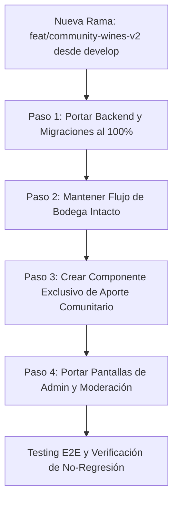

# Reporte Arquitectónico y Comparativo: develop vs feature/community-wines
**Proyecto:** AyVino  
**Fecha:** 5 de Noviembre de 2026  
**Objetivo:** Guía de reconstrucción limpia de la funcionalidad comunitaria sobre la rama `develop`, preservando la arquitectura de datos y backend y rediseñando el frontend sin los acoplamientos ni fallas UX previas.

---

## 1. Resumen Ejecutivo

Durante el desarrollo de la rama `feature/community-wines` se implementó exitosamente un robusto ecosistema de base de datos y backend para permitir que usuarios entusiastas carguen vinos no catalogados, aporten fotos de añadas y compartan consumos, mientras que los administradores obtuvieron herramientas para moderar cosechas, promover imágenes de la comunidad a oficiales y fusionar vinos duplicados.

Sin embargo, a nivel de **frontend**, la integración forzó la unificación del flujo de creación de vinos de bodega con el de los usuarios comunes dentro de un único componente (`WineCreateModal.tsx`). Esto introdujo:
1. **Acoplamiento destructivo** entre la experiencia de Bodega (que maneja datos formales y oficiales) y la experiencia de Consumidor/Comunidad (que maneja campos libres o datos parciales como "Sin añada").
2. **Un asistente interceptor (`WineCreationFlow.tsx`)** que forzaba pasos de descorche/cava e interrumpía la navegación natural.
3. **Regresiones visuales y de estado** en la vista de detalle de vino (`WineDetailPage.tsx`) y conflictos con mejoras recientes introducidas en `develop` (como el rediseño de Maridajes y refactor de Cava).

**Conclusión estratégica:** La capa de base de datos (migraciones FluentMigrator), contratos DTO y servicios backend de `feature/community-wines` son excelentes, seguros (transacciones ACID, integridad referencial y borrado seguro en Cloudinary) y cuentan con cobertura de tests. Para rehacer la funcionalidad de forma limpia y alineada a los requerimientos reales, se debe **reutilizar al 100% el backend y la base de datos**, aislando por completo en el frontend los flujos de Bodega y Comunidad.

---

## 2. Comparativa: Perfil Bodegas

### 2.1 En `develop` (Línea Base Estable)
* **Propósito del Perfil:** El usuario con rol `Winery` o `Admin` gestiona exclusivamente los vinos oficiales de su establecimiento.
* **Componente de Creación:** `WineCreateModal.tsx` actúa como formulario modal simple y directo:
  - Selector de bodega preseleccionado o bloqueado a la bodega del usuario autenticado.
  - Campos formales estrictos: Nombre comercial, tipo de vino, varietales/cepas con porcentajes, notas de cata y añadas oficiales.
  - No existen conceptos de "bodega no registrada", "sin añada" ni advertencias de duplicación por aportes de terceros.
* **Flujo de Usuario:**
  1. La bodega entra a su panel o catálogo.
  2. Pulsa "Nuevo Vino".
  3. Completa los datos técnicos y guarda.
  4. El vino queda creado como vino oficial verificado.

### 2.2 En `feature/community-wines` (Rama Problemática)
* **Sobrecarga de Responsabilidades en `WineCreateModal.tsx`:**
  - Se introdujo una propiedad `mode: 'user' | 'winery'`.
  - En modo bodega, el componente heredó validaciones en tiempo real (`GET /api/wines/match`) disparadas por debounce al tipear nombre y bodega.
  - Se incluyeron checkboxes como "Sin añada" (`isNonVintage`), selecciones de estado de consumo inmediato ("¿Ya lo tomaste?", "¿Lo querés en tu cava?") y sugerencias de "Adopción de Vino".
* **Impacto Negativo:**
  - Las bodegas experimentaron advertencias de colisión cuando intentaban cargar sus propios vinos si algún usuario entusiasta ya había subido un vino similar de manera informal.
  - La UI quedó saturada de lógica condicional ternaria (`isUserMode ? ... : ...`), provocando renders innecesarios, campos desalineados y validaciones bloqueantes que rompieron la fluidez del perfil Bodega.
  - Se agregó el componente `WineCreationFlow.tsx`, un modal tipo wizard que tras guardar preguntaba obligatoriamente si se deseaba agregar la botella a la cava personal, flujo completamente ajeno al administrador de una bodega profesional.

### 2.3 Backend y Persistencia para Bodegas (A Preservar)
A pesar de las fallas de UI, en el backend se crearon mecanismos de alto valor para bodegas que deben replicarse:
1. **Identificador Determinista `label_key`:**
   - Permite agrupar vinos por identidad normalizada: `nombre_normalizado|bodega_normalizada|tipo_vino_enum`.
2. **Propagación en Cascada en `WineryRepository.UpdateAsync`:**
   - Si una bodega cambia su nombre o razón social en su perfil, el repositorio ejecuta una transacción PostgreSQL que recalcula automáticamente el `label_key` de todos los vinos asociados a esa bodega:
   ```csharp
   // Recálculo atómico de label_keys al renombrar bodega
   await transaction.Connection.ExecuteAsync(
       @"UPDATE wines 
         SET label_key = LOWER(REGEXP_REPLACE(name, '[^a-zA-Z0-9]', '', 'g')) || '|' || @NormalizedWinery || '|' || wine_type,
             updated_at = NOW()
         WHERE winery_id = @WineryId",
       new { WineryId = id, NormalizedWinery = normalizedName },
       transaction);
   ```
3. **Protección de Identidad:**
   - Un usuario de la comunidad no puede pisar ni modificar atributos de una añada verificada cargada previamente por la bodega.

---

## 3. Comparativa: Perfil Administrador

### 3.1 En `develop` (Línea Base)
* **Gestión de Vinos (`AdminWinesPage.tsx`):**
  - Listado básico de vinos del sistema.
  - Alta, baja y edición estándar.
  - No cuenta con herramientas para detectar duplicados ni consolidar cargas hechas por diferentes personas.
* **Gestión de Cosechas (`AdminVintagesPage.tsx`):**
  - CRUD básico de añadas vinculadas a un vino (año, alcohol, stock referencial).
  - No hay visión sobre fotos enviadas por la comunidad ni trazabilidad de usuarios que registraron actividad en dicha cosecha.

### 3.2 En `feature/community-wines` (Funcionalidad Clave a Rescatar)
En esta rama, el perfil Administrador ganó herramientas profesionales indispensables para curar contenido generado por usuarios (UGC):

#### A. Pestaña de Aportes Comunitarios (`AdminVintagesPage.tsx`)
* Los administradores pueden inspeccionar cada cosecha y visualizar:
  - Cantidad total de usuarios que agregaron esa cosecha a su cava.
  - Cantidad de usuarios que la marcaron como "Tomado" (descorchado).
  - Galería de fotos enviadas por la comunidad con indicación de fecha y usuario aportante.

#### B. Promoción de Foto de la Comunidad a Oficial (`promote-image`)
* Si una cosecha no tiene foto de etiqueta oficial (o la que tiene es de baja resolución) y un usuario sube una foto de alta calidad, el administrador cuenta con un botón **"Promover a imagen oficial"**.
* **Comportamiento en Backend:**
  - Asigna la `image_url` comunitaria como la foto oficial de la cosecha (`vintages.image_url`).
  - No borra el aporte comunitario original (para preservar la autoría).
  - Evita el borrado físico en Cloudinary si el usuario borra su foto personal posterior a la promoción (`IsReferencedAsync`).

#### C. Fusión y Consolidación de Vinos Duplicados (`POST /api/wines/admin/merge`)
* Resuelve el problema típico de plataformas comunitarias: dos usuarios escriben *"Catena Zapata Malbec 2020"* y *"Catena Zapata - Malbec 2020"*.
* El Administrador selecciona el **Vino de Origen (duplicado)** y el **Vino de Destino (oficial/canónico)**.
* **Transacción Atómica de Merge (`WineRepository.MergeWinesAsync`):**
  1. Reubica todas las reseñas (`reviews`) del vino de origen hacia el vino de destino.
  2. Reasigna los registros de cava (`user_wines`) evitando duplicados por usuario.
  3. Reubica las actividades comunitarias (`user_activities`) y fotos (`user_vintage_images`).
  4. Si una cosecha no existía en el destino, transfiere la cosecha completa.
  5. Elimina el vino duplicado huérfano de manera segura.
  6. Escribe una entrada de auditoría en la base de datos registrando el ID del admin y la fecha del merge.

---

## 4. Conexiones con el Backend y Base de Datos

Esta sección contiene el detalle exacto de las estructuras de datos y migraciones que **deben replicarse en la nueva rama**.

### 4.1 Migraciones FluentMigrator

#### 1. `M20261031001_AddLabelKeyToWines.cs`
Agrega la columna `label_key` para la detección determinista de homónimos.
```csharp
[Migration(20261031001)]
public class M20261031001_AddLabelKeyToWines : Migration
{
    public override void Up()
    {
        Alter.Table("wines")
            .AddColumn("label_key").AsString(500).Nullable();

        Create.Index("ix_wines_label_key")
            .OnTable("wines")
            .OnColumn("label_key");
    }

    public override void Down()
    {
        Delete.Index("ix_wines_label_key").OnTable("wines");
        Delete.Column("label_key").FromTable("wines");
    }
}
```

#### 2. `M20261031002_CreateUserVintageImagesTable.cs`
Tabla para que cualquier usuario pueda subir su foto personal de una botella.
```csharp
[Migration(20261031002)]
public class M20261031002_CreateUserVintageImagesTable : Migration
{
    public override void Up()
    {
        Create.Table("user_vintage_images")
            .WithColumn("id").AsInt32().PrimaryKey().Identity()
            .WithColumn("user_id").AsInt32().NotNullable()
                .ForeignKey("fk_user_vintage_images_user", "users", "id")
                .OnDelete(Rule.Cascade)
            .WithColumn("vintage_id").AsInt32().NotNullable()
                .ForeignKey("fk_user_vintage_images_vintage", "vintages", "id")
                .OnDelete(Rule.Cascade)
            .WithColumn("image_url").AsString(1000).NotNullable()
            .WithColumn("public_id").AsString(255).Nullable()
            .WithColumn("created_at").AsDateTime().NotNullable().WithDefault(SystemMethods.CurrentDateTime)
            .WithColumn("updated_at").AsDateTime().NotNullable().WithDefault(SystemMethods.CurrentDateTime);

        Create.Index("ix_user_vintage_images_vintage_id")
            .OnTable("user_vintage_images")
            .OnColumn("vintage_id");

        Create.Index("ix_user_vintage_images_user_vintage")
            .OnTable("user_vintage_images")
            .OnColumns("user_id", "vintage_id");
    }

    public override void Down()
    {
        Delete.Table("user_vintage_images");
    }
}
```

#### 3. `M20261031003_CreateUserActivitiesTable.cs`
Registra eventos de comunidad (`CellarAdd`, `Tried`, `PhotoUploaded`) para calcular popularidad y habilitar la visibilidad comunitaria.
```csharp
[Migration(20261031003)]
public class M20261031003_CreateUserActivitiesTable : Migration
{
    public override void Up()
    {
        Create.Table("user_activities")
            .WithColumn("id").AsInt32().PrimaryKey().Identity()
            .WithColumn("user_id").AsInt32().NotNullable()
                .ForeignKey("fk_user_activities_user", "users", "id")
                .OnDelete(Rule.Cascade)
            .WithColumn("vintage_id").AsInt32().NotNullable()
                .ForeignKey("fk_user_activities_vintage", "vintages", "id")
                .OnDelete(Rule.Cascade)
            .WithColumn("activity_type").AsString(50).NotNullable()
            .WithColumn("created_at").AsDateTime().NotNullable().WithDefault(SystemMethods.CurrentDateTime);

        Create.Index("ix_user_activities_vintage_id")
            .OnTable("user_activities")
            .OnColumn("vintage_id");
    }

    public override void Down()
    {
        Delete.Table("user_activities");
    }
}
```

#### 4. `M20261102001_AddIndexToUserActivitiesOnVintageAndUser.cs`
Optimiza las consultas de conteo y verificación de descorche por usuario.
```csharp
[Migration(20261102001)]
public class M20261102001_AddIndexToUserActivitiesOnVintageAndUser : Migration
{
    public override void Up()
    {
        Create.Index("ix_user_activities_vintage_user")
            .OnTable("user_activities")
            .OnColumns("vintage_id", "user_id");
    }

    public override void Down()
    {
        Delete.Index("ix_user_activities_vintage_user").OnTable("user_activities");
    }
}
```

---

## 5. Catálogo Completo de Endpoints y Contratos DTO

### 5.1 Endpoints para Consumidores y Comunidad

| Método | Endpoint | Rol Requerido | Descripción |
| :--- | :--- | :--- | :--- |
| `GET` | `/api/wines/match?name={n}&winery={w}&year={y}` | Autenticado | Busca vinos similares para evitar duplicados antes de crear uno nuevo. |
| `GET` | `/api/wines/vintages/{vintageId}/my-image` | Autenticado | Devuelve la foto personal subida por el usuario logueado para esa cosecha. |
| `PUT` | `/api/wines/vintages/{vintageId}/my-image` | Autenticado (`multipart/form-data`) | Sube o reemplaza la foto personal en Cloudinary y DB. |
| `DELETE`| `/api/wines/vintages/{vintageId}/my-image` | Autenticado | Elimina la foto personal (aplica `IsReferencedAsync` en Cloudinary). |
| `POST` | `/api/wines/vintages/{vintageId}/uncork` | Autenticado | Registra actividad `Tried` ("Descorchado") para ese usuario y cosecha. |

### 5.2 Endpoints para Moderación y Administrador

| Método | Endpoint | Rol Requerido | Descripción |
| :--- | :--- | :--- | :--- |
| `GET` | `/api/admin/vintages/{vintageId}/contributions` | `Admin` | Lista fotos subidas por usuarios y métricas de consumo de una cosecha. |
| `POST`| `/api/admin/vintages/{vintageId}/promote-image` | `Admin` | Promueve una foto comunitaria (`imageId`) a foto oficial de la añada. |
| `POST`| `/api/wines/admin/merge` | `Admin` | Fusiona un vino duplicado en otro canónico transfiriendo historial. |

### 5.3 Contratos y DTOs Clave (Backend C#)

#### DTO: Búsqueda de Coincidencia (`WineMatchResultDto`)
```csharp
public record WineMatchResultDto(
    bool ExactMatch,
    int? WineId,
    string? WineName,
    int? WineryId,
    string? WineryName,
    List<VintageMatchDto> Vintages,
    double SimilarityScore
);

public record VintageMatchDto(int VintageId, int Year, string? ImageUrl);
```

#### DTO: Fusión de Vinos (`MergeWinesRequestDto`)
```csharp
public record MergeWinesRequestDto(
    [Required] int SourceWineId,
    [Required] int TargetWineId,
    string? Reason
);
```

#### DTO: Promoción de Imagen (`PromoteImageRequestDto`)
```csharp
public record PromoteImageRequestDto(
    [Required] int ImageId
);
```

#### DTO: Contribuciones de Cosecha (`VintageContributionsDto`)
```csharp
public record VintageContributionsDto(
    int VintageId,
    int TotalCellared,
    int TotalTried,
    List<UserVintageImageDto> CommunityImages
);

public record UserVintageImageDto(
    int Id,
    int UserId,
    string UserName,
    string ImageUrl,
    DateTime CreatedAt,
    bool IsOfficial
);
```

---

## 6. Diagnóstico: ¿Por Qué Falló el Frontend de la Rama Previa?

1. **Violación de Responsabilidad Única (SRP):**
   - Se modificó `WineCreateModal.tsx` para atender dos actores con requerimientos opuestos:
     * **Bodega:** Necesita catálogo estricto, precisión en cepas, notas oficiales y control corporativo.
     * **Comunidad:** Necesita carga rápida desde celular, quizás no sabe las cepas exactas, o quiere subir una foto de una botella que está tomando en un asado.
   - Querer hacer todo en un solo componente infló el archivo a casi 1.300 líneas con estados cruzados inmanejables.

2. **Wizard Invasivo (`WineCreationFlow.tsx`):**
   - Al terminar de cargar un vino, el modal no se cerraba; abría una segunda pantalla modal exigiendo al usuario decidir si guardaba la botella en su cava, con cuántas unidades y si ya la había probado.
   - Para las bodegas, este paso carecía totalmente de sentido y generaba frustración.

3. **Divergencia con las Mejoras de `develop`:**
   - Mientras se trabajaba en la rama community, en `develop` se aprobaron refactors mayores a la vista de Maridajes y filtros de catálogo. Al intentar fusionar o sincronizar, se rompieron estilos globales y selectores.

---

## 7. Plan de Acción Recomendado (Blueprint de Reconstrucción)

Para rehacer la funcionalidad comunitaria de forma impecable, se aconseja seguir estos 4 pasos:



### Paso 1: Portar Backend y Migraciones
- Crear la rama `feat/community-wines-v2` directamente desde la punta de `develop`.
- Reincorporar las 4 migraciones FluentMigrator (`M20261031001` a `M20261102001`).
- Portar los repositorios `WineRepository.cs`, `WineryRepository.cs`, `UserVintageImageRepository.cs` y los endpoints del controlador de vinos y admin.
- Ejecutar los tests unitarios e integrados del backend para garantizar 100% de éxito.

### Paso 2: Preservar el Perfil Bodegas Intacto
- **No tocar `WineCreateModal.tsx` original.**
- El modal de bodegas debe seguir siendo exclusivamente para bodegas y administradores gestionando vinos oficiales.

### Paso 3: Crear una Experiencia Comunitaria Desacoplada
- Crear un nuevo componente específico: `src/frontend/src/features/wines/components/CommunityWineCreateModal.tsx`.
  - Diseñado exclusivamente para entusiastas.
  - Interfaz simple: Nombre, Bodega (texto libre o selector sugerido), Año de cosecha y Foto directa desde cámara/archivo.
  - Al crearse, invoca `/api/wines/match` para avisar si el vino ya existe y sugerir unirse a él sin duplicar.
- En la vista de detalle de vino (`WineDetailPage.tsx`):
  - Añadir una sección o pestaña discreta: *"Fotos de la Comunidad"*, donde los usuarios puedan pulsar *"Subir mi foto"* usando el endpoint `/my-image`.
  - Añadir botón *"Ya lo probé"* que consuma `/api/wines/vintages/{id}/uncork`.

### Paso 4: Reutilizar el Panel de Administración de Moderación
- Portar el componente `AdminVintagesPage.tsx` y el modal de `AdminMergeWinesModal.tsx` tal como se habían diseñado para el perfil Admin, ya que su funcionalidad fue limpia, modular y no interfería con las vistas públicas.

---
*Reporte generado para el equipo de desarrollo de AyVino.*

